# Victory Academy — Proposed Implementation Plan

> **Basis:** full read of the uploaded `victory-contest.zip` (backend, student frontend, admin panel) against the client's task list.
> **Excluded by instruction:** School / Institutional Management (task-list §18) and the `victory-academy/` folder.
> **Date of analysis:** 13 Oct 2026. **Revision 4** incorporates all three rounds of client answers (§0.1 and §0.2).

### How to read this document

| Marker | Meaning |
|---|---|
| ✅ | Implemented and matches the plan |
| 🟡 | Partially implemented, or implemented for one area only |
| ⚠️ | Implemented, but the design **does not fit** the proposed model (needs rework, not just extension) |
| ❌ | Not implemented |
| ⚪ | Not needed (the client decided against it) |
| `✔ verified` | I read the code that proves this |
| `◐ inferred` | Strong evidence from the code, but I did not run it. Confirm before relying on it |

File paths are relative to the repo root. `BE` = `backend/`, `FE` = `frontend/` (student Telegram Mini App), `AD` = `admin-page-clean/`.

---

## 0. Housekeeping first: remove `victory-academy/`

`victory-academy/` is the original standalone mock prototype. Its code was merged into `FE/src/academy/**` and `AD/src/academy/**`, and its mock layer has already been deleted from both apps (`ACADEMY_BACKEND_NOTES.md`). No build file, Dockerfile, compose file or doc references it.

```bash
git rm -r victory-academy
git commit -m "chore: remove obsolete victory-academy prototype"
```

I have removed it from my working copy and excluded it from every finding below. I cannot modify your uploaded zip, so run the command above in your repository.

Also delete or rewrite the stale root docs while you are there (see **D13**).

---

## 0.1 Client decisions incorporated (revision 2)

The client answered the open questions from revision 1. They are now built into the plan. Where an answer changed the design, the affected section is listed.

| # | Client decision | What it changes in this plan | Where |
|---|---|---|---|
| 1 | Programs are **not limited to four**: Grade 9/10/11/12, Entrance Exam (Grade 12), Remedial, Freshman, Exit Exam, Training & Habit Development, and **more later** | Programs are pure data with feature flags; nine are seeded (three new: Entrance Exam, Freshman, Training); nothing is deactivated; adding a program never needs code | §5.1, §6.4 |
| 2 | **`Common` stream:** subjects shared by Natural and Social (English, Maths…) must appear for both; Freshman uses common courses | `common` is a first-class stream: content tagged `common` is visible to every enrollment of the program; common-only programs (Freshman, Grade 9/10, Training) skip the stream step | §5.1, §5.2 |
| 3 | Every program has **free and premium** content; anyone can **explore** any program; registration opens the student's chosen program by default | Free content is open to everyone; premium is unlocked per program; the home feed defaults to the registered program with an "Explore" widening | §5.3, §5.7, §7.1 |
| 4 | Leaderboards by **Today / This Week / This Month / All Time**, plus program-based boards; "pick the best points method" | Decided: **percentage points per assessment, summed within the period**, tie-break on time. Boards per program and per stream | §5.5 |
| 5 | **Self-paced:** start any time after the opening time, **even after the "until" time**; answers revealed at "until" for those who already finished; the first attempt is the recorded one (decision 15) | No upper start limit; answers visible only to finished attempts and only from "until" | §5.4 |
| 6 | **Late policy:** submissions after "until" lose a configurable share of points (**default 10%**, set per contest); late students still appear on the leaderboard and still see their result | `late_penalty_percent` on the contest; `is_late` flag on the attempt; penalised points feed the leaderboard; admin can waive a penalty | §5.4, §5.5 |
| 7 | A student may be **enrolled in several programs** at once | Multi-enrollment with a "My programs" switcher | §5.2, §7.1 |
| 8 | **Passwords for admins only**; students use Telegram auto-auth | No student password work; Appendix item closed | Appendix A |
| 9 | **Telegram Mini App only** | Content-protection scope is cut to what a Telegram WebView can do; offline becomes a feasibility spike, not a commitment | §5.9 |
| 10 | **Region and city: fixed lists plus "Other" (free text), editable by admins; school stays free text** | New admin-managed locations list; students store stable ids plus optional free text; school grouping is normalised in analytics | §5.1, §5.11, §10.1 |
| 11 | Privacy/retention rules **not needed for now** | Dropped from the open questions; access auditing stays an optional, minimal item | §5.9 |

**Round-2 answers** follow in §0.2; no open questions remain (§11).

---

## 0.2 Client decisions, round 2 (revision 3)

| # | Client decision | Effect on the plan | Where |
|---|---|---|---|
| 12 | **Grade 12 and Entrance Exam are separate programs**, even though both serve Grade 12 students | Assumption confirmed. Today's `grade-12` content stays where it is; the *Move subject* tool re-homes whatever belongs to Entrance Exam | §5.1 |
| 13 | **Late = submitted after "until"**, even if the student started on time | Implemented exactly as worded; admins can still waive an individual penalty | §5.4.1 |
| 14 | **Gregorian everywhere in the backend and database**; Ethiopian calendar can be converted on the frontend later | All stored times, period keys and boards are Gregorian/UTC. Each app routes every displayed date through one formatter, so adding the Ethiopian calendar is a one-file change | §5.5, §6.2 |
| 15 | **Unlimited attempts, but only the first is recorded; the editorial shows it. Do not record every attempt** | One stored attempt per student per assessment. Retakes are unrecorded practice runs, graded on the device from the editorial data, available once answers are visible | §5.4.3 |
| 16 | **No public ranking for Training/habits.** Leaderboards exist only for contest-style points; addiction, gym and similar habits are never scored | No habit board, no habit points. Habit progress is private to the student and visible to admins | §5.10 |
| 17 | **The developer seeds the location lists**; the client sends updates when needed | A seed file in the repo plus the admin Locations page for later edits; nothing waits on the client | §5.1, §10.1 |
| 18 | **Pricing must be professionally configurable by an admin**, "like Udemy" or per program | New section: price plans (single program, bundle, all-access), flexible validity, list and sale prices, coupons, ETB and Telegram Stars prices, entitlements with renewal, grants and revocation | §5.12 |
| 19 | **`other-programs` is the generic home for specialized short courses**; Training & Habit is one of them, and any future program must be easy to create | No special-casing. Program CRUD in the admin panel is the mechanism for every current and future program | §5.1, §6.4 |
| 20 | **3-day grace period** after access expires | `entitlement_grace_days` setting, default 3; access continues with a "renew now" banner | §5.12 |
| 21 | **Admins generate coupons themselves** (code, expiry, limits) | Coupons move from Phase 5 into **Phase 1** | §5.12, §9 |
| 22 | **Keep streaks for habits** so students pay attention | Streaks, milestone badges and a streak-at-risk nudge are kept (personal, never public, not points) | §5.10 |
| 23 | **Keep payments as they are today** (manual bank transfer with proof, plus Telegram Stars) | No new gateways | §5.12 |

---

## 1. Executive summary

### What you have

A working, reasonably hardened platform. Since the README was written, the code has gained real student JWT auth (Telegram `initData`), admin auth, server-side grading, answer hiding during live contests, rate limiting, schema auto-migration (`BE/internal/schema/tables.go`), 58 backend test files, and a full Academy (lectures, quizzes, flashcards, AI drafts, referral unlocks, watermarking). The README and root docs are **out of date** and understate this.

### What is missing: one idea, five consequences

The client's central request is that **everything is organised by program / stream / grade / subject, students see content tailored to them, and admins manage each slice independently.** Today, only the *Academy* has that taxonomy. Everything else is flat and global:

| Area | Today | Consequence |
|---|---|---|
| Students | `grade` only. No program, no stream, one global `is_premium` flag | Cannot tailor content or leaderboards; cannot sell a second program |
| Contests | Free-text `subject` + `grade`; no program/stream | Home page downloads **all** contests and filters by grade in the browser |
| Questions | Free-text `subject` / `grade` / `chapter` | Question bank cannot be filtered or managed per program |
| Leaderboard | One global board built from a **full scan** of all submissions | Cannot be split by program/stream; slow as data grows |
| Admin | Flat sidebar; Academy is an island under `/dashboard/academy` | No way to "work inside Grade 12 Natural Science" |

### The five biggest findings

1. **The contest engine is global-only and trusts the client for timing.** The timer is `end_time − now` computed in the browser (`FE/src/pages/Contest.tsx`). The server stores no start time, does not check that a contest is open when you submit, does not prevent double submission, and records `time_spend` as a client-supplied string. **Per-student/self-paced contests are impossible without a new server-side `Attempt` entity.** This is the single highest-risk change.
2. **Premium contests are not protected on the server.** There is no premium check anywhere in the contest/submission code path (`grep` of `contest_handler.go`, `contest_usecase.go`, `submission_*` returns nothing). `contest.type === "premium"` is only checked in the React app (`FE/src/pages/Home.tsx`). Any free user can call `GET /api/contest/:id` and `POST /api/submission/`.
3. **Likely data bug: grades are stored as `"1"`–`"4"` instead of `"9"`–`"12"`.** The registration form uses `value={`${i+1}`}` with label `Grade {9+i}` (`FE/src/pages/StudentRegisteration.tsx`). Contests use `"9"`–`"12"` (`AD/src/components/questions/Data.tsx`), and `sameGrade()` compares digits. A Grade 12 student (`"4"`) would never match a Grade 12 contest (`"12"`). **Verify first with a `DISTINCT grade` query on the `student` table.**
4. **Programs are hardcoded in four places**, so "add a new program later" currently needs a code change and a deploy: the TS `LevelId` union (`FE/src/types/academy.ts`), the `LEVEL_SHORT` map (`FE/src/academy/lib/theme.ts`), Go's `academyProgramOrder` and `academyLevelFromGrade` (`BE/internal/usecase/academy_usecase.go`). The client has confirmed the program list is **open-ended**: Grade 9/10/11/12, Entrance Exam, Remedial, Freshman, Exit Exam, Training & Habit Development, and more later. The seed already has most of them but lacks **Entrance Exam, Freshman and Training**, and only the Academy knows about programs at all.
5. **Scaling hot spots will hurt before the user base is large.** `GetContestByID` scans the **entire** question table on every call; badge evaluation calls it once per past submission (O(submissions × all questions)); the leaderboard scans all submissions on every request.

### The proposed fix, in one picture

Introduce **four small shared concepts** and route everything through them. Nothing else needs to be invented.

```
 ┌────────────────────────────────────────────────────────────────────────┐
 │ 1. CATALOG      Program → Stream → Subject → Chapter   (data, not code) │
 │ 2. SCOPE        {program, stream, grade, subject, chapter}  one struct, │
 │                 stamped on Question, Assessment, Module, Attempt, Score │
 │ 3. ACCESS       one function: can this student use this resource?       │
 │                 (enrollment + per-program payment + free + referral)    │
 │ 4. ATTEMPT      one server-side engine for every timed assessment       │
 │                 (self-paced or global, contest/exam/practice/past exam) │
 └────────────────────────────────────────────────────────────────────────┘
```

* The **Catalog already exists** as the Academy's `academy_content` documents. We promote it to the single taxonomy instead of building a new one.
* **No table renames and no URL breaking.** `contests` stays the storage name; "Assessment" becomes the product concept. New fields are optional, and existing rows are read as `mode = global`, so every current contest behaves exactly as before.
* **Adding a program later becomes an admin-panel action**, not a code change (runbook in §6.4).

### Honest effort estimate

Rough full-stack effort for one developer familiar with the codebase: **~58–77 dev-days for the whole plan (see §9)**. A *trial-release slice* (Phases 0–3: foundations, taxonomy/enrollment/access, attempt engine, leaderboards + question bank) is **~34–44 dev-days**: about 4–5 weeks with two developers, not one. "Under one month" is tight even for that slice; §9 lists exactly what to cut to hit it. Details in §9.

---

## 2. Current-state snapshot (verified)

| | Backend | Student app | Admin panel |
|---|---|---|---|
| Stack | Go 1.24, Gin, DynamoDB (21 tables, PAY_PER_REQUEST; the README says 15), Gemini via admin-configurable providers, Cloudinary, Telegram Bot | React 18, Vite, Tailwind, shadcn/Radix, react-router 7, axios (no data-fetching lib) | React 18, Vite, Tailwind, shadcn/Radix **and** MUI (`@mui/material`, `x-data-grid`, `x-charts`), TanStack Query + Table, Recharts |
| Layers | `domain / repository / usecase / handler` + `schema` migrations | `pages/`, `components/`, `academy/`, `services/` | `components/<feature>/`, `academy/admin/`, `services/` |
| Auth | Student JWT from verified Telegram `initData`; admin cookie JWT + approval | Telegram WebApp | Email/password |
| Tests | 58 `_test.go` files | **none** | **none** |
| Deploy | One Docker image serves API + both SPAs (`Dockerfile`); also Vercel/Render configs | Root-relative, `VITE_API_BASE_URL` | `base: '/admin/'`, `VITE_API_URL` |

**Cross-app duplication:** 10 files are byte-identical between `FE` and `AD` (`types/academy.ts`, `academy/components/{AccessBadge,ProgressRing,ImageViewer,PageHeader,States,SubjectTile}.tsx`, `academy/hooks/useAsync.ts`, `academy/lib/theme.ts`, `components/ui/scroll-area.tsx`). Per your note, that is acceptable: the apps may deploy separately, so each keeps its own copy. The problem is **duplication *inside* each app** (see §6).

---

## 3. Gap analysis against the client's task list

*(Your progress markers are all ⬜. This replaces them. §18 School Management is excluded.)*

### 3.1 Summary scoreboard

| Plan section | ✅ | 🟡 | ⚠️ | ❌ | ⚪ | Headline |
|---|---|---|---|---|---|---|
| 1 Programs & structure | 1 | 6 | 0 | 5 | 0 | Taxonomy exists only inside the Academy |
| 2 Registration & enrollment | 2 | 2 | 1 | 3 | 0 | No program/stream captured; grade values wrong |
| 3 Free/Premium & referral | 6 | 2 | 2 | 6 | 0 | Academy gating is solid; **contest gating is client-only** |
| 4 Lectures & learning content | 7 | 2 | 0 | 2 | 0 | Strongest area |
| 5 Contest & examination system | 1 | 4 | 3 | 14 | 0 | Needs the Attempt engine |
| 6 General assessment system | 0 | 2 | 1 | 4 | 0 | Only "contest" exists; no kinds/modes |
| 7 Question bank | 7 | 2 | 0 | 0 | 0 | Good tooling, weak categorisation, no math |
| 8 Exam interface | 3 | 4 | 0 | 1 | 0 | No flagging, no autosave/resume |
| 9 Analytics & performance | 8 | 1 | 0 | 5 | 0 | Leaderboards are the gap |
| 10 AI tutor | 3 | 3 | 0 | 0 | 0 | Works; persona hardcoded |
| 11 Training & habit development | 0 | 1 | 0 | 7 | 1 | Not started |
| 12 UI/UX | 8 | 1 | 0 | 0 | 0 | Mostly present, Academy-only |
| 13 Content protection / DRM | 2 | 3 | 0 | 3 | 0 | Server-side stripping only; rest is client-side |
| 14 Admin portal | 7 | 8 | 0 | 2 | 0 | Not program-scoped |
| 15 Admin reporting & AI | 4 | 2 | 0 | 3 | 0 | Contest-level only |
| 16 System-wide | 2 | 4 | 0 | 2 | 0 | No RBAC beyond approved admin |
| 17 AI / gamification enhancements | 1 | 1 | 0 | 3 | 0 | Streaks exist; planner/summaries missing |
| **Total (177 items, excluding not-needed)** | **62** | **48** | **7** | **60** | **1** | **35% fully done, 66% at least started** |

The line-by-line status of the client's list (a few closely related bullets are merged) is in **Appendix A**.

### 3.2 Fully implemented (keep, reuse, do not rebuild)

| Capability | Evidence |
|---|---|
| Lecture CRUD: notes (Markdown), YouTube/direct video, docs, flashcards, quizzes, activities, per-resource lock, ordering, duplicate | `AD/src/academy/admin/editor/*Tab.tsx`, `BE/internal/usecase/academy_admin.go` |
| Student learning hierarchy: program → stream → subject → chapter → module, progress, streaks, target score | `FE/src/academy/pages/*`, `BE/internal/usecase/academy_usecase.go` |
| Free / premium / referral locking, enforced **server-side** (locked resources are stripped from the payload) | `academyLocks()` in `academy_usecase.go`; per-module `ReferralUnlock{Enabled, RequiredReferrals}` (default 2, max 20) |
| Program activate/deactivate | `PATCH /admin/programs/:id` (`AdminSetProgramActive`) |
| Question bank tooling: AI document parsing, bulk add, bulk delete, typed PATCH, images on question and options, explanations | `BE/internal/handler/http/question_handler.go`, `question_usecase.go` |
| Server-side grading, answer hiding while a contest is live, editorial after end | `submission_usecase.go`, `GetContestByID` |
| Student statistics by subject / chapter / grade / trend, AI recommendations | `GET /submission/statistics/*`, `/ai/getRecommendation`, `FE/src/pages/Statistics.tsx` |
| Admin contest statistics: gender, city, school, score buckets, filters, cache | `contest_statistics_usecase.go` (note: the school/city figures are student-entered text; fine to keep, not part of the excluded school-management scope) |
| In-context AI tutor grounded in the lesson text with injection-resistant prompting | `academy_ai.go` (`<lesson>` tags, `academyPersona`) |
| Dynamic watermark, copy/context-menu blocking, blur-on-blur, image fullscreen/zoom, font size, theme, data saver | `FE/src/academy/components/ProtectedContent.tsx`, `ImageViewer.tsx`, settings sheet |
| Payments (manual verification), suspension, notifications, articles, polls/feedback, page-view analytics | respective handlers/pages |

### 3.3 Partially implemented

| Capability | What exists | What is missing |
|---|---|---|
| Programs | 7 seeded Academy programs, active toggle | Entrance Exam, Freshman and Training programs; not data-driven (4 hardcoded places); no enrollment; not linked to contests/questions/students |
| Streams | Academy subjects carry `stream_id` | Not on students, contests, questions, leaderboards |
| Student filtering (admin) | Search, grade, city on `AD/src/components/users/Users.tsx` | No program/stream/subscription/status filters; grade filter is broken (D12); cities hardcoded to 4 |
| Contest timing | Global `start_time`/`end_time`, client countdown | Duration, per-student timer, server enforcement |
| Auto-submit | Client calls submit at 0:00 | Server-side expiry |
| Question categorisation | Free-text subject/grade/chapter | Program, stream, topic, year, source, verified flag; server filter |
| Exam UI | Timer, question dropdown, image modal | Flagging, answered/flagged palette, autosave, resume, intro screen with rules |
| Premium conversion | `PremiumSheet` + Academy `UpgradeSheet` | Two sheets doing similar jobs; no per-program price/plan |
| Admin analytics | Per-contest stats, dashboard totals | Cross-assessment, program/stream/region analytics; export; AI summaries |
| AI personalisation | Recommendations + tutor | Admin-editable teaching style; no weekly review planner |
| Content protection | Watermark, copy block | No signed media URLs, no download restriction, no offline encryption, no access audit |

### 3.4 Not implemented

* Program enrollment, per-program payments, department/program on registration
* Program- and stream-separated leaderboards; leaderboard privacy rules
* Admin-configurable pricing: plans, bundles, sale prices, coupons, and per-program entitlements with expiry
* Self-paced contests, individual timers, individual result release, start/complete timestamps, late/expired/abandoned handling
* Assessment kinds (practice, entrance, past national exam, makeup), `year`/`source` for past exams
* Math/equation/table rendering in questions
* Question flagging, autosave, resume after refresh
* **All of Training & Habit Development** (30-day plan, daily checklist, streak/ranking, admin oversight)
* Bulk upload of lecture resources; video hosting/upload
* Role-based access control beyond a single "approved admin"
* About page, social links
* Competency mapping; AI report summaries; export of analytics

### 3.5 Implemented, but does **not** meet the proposed model (rework needed)

| # | Feature | Why it does not fit | Fix (section) |
|---|---|---|---|
| ⚠1 | **Leaderboard** | One global board: `GetAllSubmissions()` full scan, sums raw scores across all contests, top 100, no program/stream/period dimension (`submission_usecase.go`) | §5.5 |
| ⚠2 | **Contest result release** | Tied to the global `EndTime` (`ContestHasEnded`). Under self-paced mode a student would see answers (or never see them) based on someone else's clock | §5.4 |
| ⚠3 | **Premium model** | One boolean derived from "any approved unexpired payment". Cannot represent "paid for Grade 12 but not Training" | §5.2 |
| ⚠4 | **Student level/stream (Academy)** | Stored in a *separate* table (`academy_students`), derived from grade with a silent default to `natural-science`, and the student can PATCH `/me` to any level for free | §5.2 |
| ⚠5 | **Contest ↔ Academy relationship** | Contest `subject` is a free-text string from a hardcoded admin list, unrelated to Academy subjects/chapters. Same subject exists twice with no link | §5.1 |
| ⚠6 | **Contest "registration" step** | `contest_registeration` is the seed of an attempt (register → "activate") but has no timestamps/status, its routes bypass student auth, and "isActive" is a GET with side effects | Becomes `Attempt` (§5.4) |

---

## 4. Defects and improvements found (independent of the plan)

Severity: 🔴 fix before trial · 🟠 fix in the phase noted · 🟡 hygiene.
`✔` = verified in code, `◐` = strong inference, confirm.

| ID | Sev | Finding | Evidence | Fix | Phase |
|---|---|---|---|---|---|
| **D1** | 🔴 | Grade stored as `"1"`–`"4"`, expected `"9"`–`"12"`; breaks contest matching and Academy level mapping (falls back to `grade-12` by accident) ◐ | `FE/src/pages/StudentRegisteration.tsx` select values; `FE/src/lib/utils.ts#sameGrade`; `academyLevelFromGrade` | Run `SELECT DISTINCT grade`; fix the form; migration normalises (§10.1); validate server-side | 0 |
| **D2** | 🔴 | Premium contests unprotected server-side; every contest listed to everyone; any contest fetchable ✔ | `contest_handler.go`, `contest_usecase.go` contain no entitlement check | Access service (§5.3) applied in list/get/start | 1–2 |
| **D3** | 🔴 | Timing is client-only and global; refresh loses answers and re-derives timer from `end_time` ✔ | `FE/src/hooks/useContestTimer.ts`, `Contest.tsx` | Attempt engine (§5.4) | 2 |
| **D4** | 🔴 | `AddSubmission` has no open-window check, no duplicate guard, trusts client `time_spend` ✔ | `submission_handler.go`, `submission_usecase.go` | Attempt-based submit with conditional write | 2 |
| **D5** | 🟠 | Per-student read endpoints sit outside the auth group: editorial, statistics, rank by `:student_id` (IDOR). `contest-registration` POST and `isActive` lack student auth ✔ | `router.go`, `submission_handler.go` | Move under `studentAuth`; derive the student id from the JWT, never from the path | 0 |
| **D6** | 🟠 | `GetContestByID` calls `GetAllQuestions()` (full scan) per request; badge evaluation calls it per past submission ✔ | `contest_usecase.go`, `submission_usecase.go` | `BatchGetItem` by id; evaluate badges only on the new attempt | 0 |
| **D7** | 🟠 | Leaderboard full scan + recompute on every call ✔ | `submission_usecase.go` | Precomputed boards (§5.5) | 3 |
| **D8** | 🟠 | Student can self-switch Academy level/stream; stream silently defaults ✔ | `UpdateMe`, `academyDefaultStream` | Enrollment model; stream required at registration | 1 |
| **D9** | 🟡 | Academy snapshot cache is per-process (20 s TTL): stale/inconsistent if you ever run 2+ instances. `ListContent` is a full scan; each doc is one DynamoDB item (400 KB cap) ✔ | `academy_usecase.go`, `academy_repository` | Fine at current size; add `updated_at` version check or a short TTL; document the limit | 4 |
| **D10** | 🟠 | Hardcoded lists: grades and subjects (`AD/.../questions/Data.tsx`), the region dropdown (`FE/src/pages/StudentRegisteration.tsx`), four cities in the admin Users filter (`AD/.../Users.tsx`), program ids ✔ | listed files | Catalog + admin-managed Locations (§5.1) | 1 |
| **D11** | 🟠 | Contest PATCH uses reflection with a string-only whitelist; cannot patch ints/bools/nested (`mode`, `duration`, `scope`) ✔ | `contest_handler.go` | Typed `ContestPatch` with pointer fields (same pattern as `QuestionPatch`) | 2 |
| **D12** | 🟠 | Admin Users grade filter values (`"Grade 12"`…, lowercased) never equal stored values (`"12"`/`"4"`) ◐ | `AD/src/components/users/Users.tsx` | Replace with Catalog-driven filters | 4 |
| **D13** | 🟡 | Stale docs and comments: README says no auth/no tests/15 tables; `DeleteSubmission` comment says "No auth yet" while it is behind auth | `README.md`, `submission_handler.go` | Replace root docs with one accurate `README.md` + `docs/ARCHITECTURE.md` (Phase 8) | 8 |
| **D14** | 🟠 | Zero automated tests in both frontends ✔ | repo | Vitest for pure logic (scope, timer, access); Playwright smoke for exam flow | 8 |
| **D15** | 🟡 | Duplicates inside admin: `contests/ContestStatistics.tsx` (611 lines) vs `profile/ContestStatistics.tsx` (363), `contests/Questions.tsx` vs `questions/Questions.tsx`; `profile/PaymentManagement.tsx` (640) behind a 20-line wrapper in `settings/` ✔ | listed files | Consolidate (§6.1) | 4 |
| **D16** | 🟡 | Admin ships **two UI systems** (shadcn/Radix and MUI + MUI DataGrid) and three chart/table libraries ✔ | `AD/package.json` | Standardise on shadcn + TanStack Table + Recharts over time; stop adding MUI | 4+ |
| **D17** | 🟠 | Videos are raw URLs (YouTube or direct file). No signed URLs, so "download restriction" is impossible ✔ | `AD/.../VideoTab.tsx` | §5.9 | 7 |
| **D18** | 🟠 | Exam questions render as plain text: no math, tables ✔ | no Markdown/KaTeX in `Contest.tsx`, `ContestEditorial.tsx`, admin question editor | Reuse the Academy `Markdown` renderer (§5.6) | 3 |
| **D19** | 🟡 | AI teaching persona is a Go constant; `AISettings` holds only `require_premium` ✔ | `academy_ai.go`, `domain/ai_settings.go` | Add `persona`/`style_notes` fields to settings | 7 |
| **D20** | 🟡 | `Admin` has no role; only `is_approved` ✔ | `domain/admin.go` | Roles + program scoping (§5.8) | 5 |

> **Do D1, D5, D6 immediately and independently.** They are small, they are bugs today, and D1 silently corrupts the data that the new categorisation depends on.

---

## 5. Target architecture

### 5.0 Design rules (to avoid over-engineering)

1. **No new microservices, no new database, no table renames, no URL breaks.** All additions are optional fields, a few new tables and a few new routes.
2. **One taxonomy.** Reuse the Academy's Program → Stream → Subject → Chapter documents as the catalog for lectures, questions, contests, leaderboards and analytics.
3. **One struct, `Scope`, carries categorisation everywhere.** Every list/filter/permission/leaderboard question is answered by comparing Scopes, written once.
4. **One access function.** Premium/free/referral/enrollment rules live in one place.
5. **One attempt engine** for every timed assessment.
6. **Defaults preserve today's behaviour.** Missing new fields mean "legacy global contest, free, grade-12". Old data keeps working with no big-bang migration.
7. **Programs are data.** If adding a program requires editing Go or TypeScript, the design has failed.
8. **Behaviour comes from data flags** (`features`, enrollable streams), never from a program id or kind.

### 5.1 Catalog: programs, streams, subjects, chapters, locations

**What changes:** promote the Academy's existing documents to the shared catalog, make programs fully data-driven (the client confirmed the list is open-ended), and add admin-managed location lists.

#### Programs are data, and the list is open-ended

Seed data after migration (all editable in the admin panel afterwards; **nothing existing is deactivated or deleted**):

| Program | `id` | Enrollable streams | Features | Seed status |
|---|---|---|---|---|
| Grade 9 | `grade-9` | `common` | lectures, assessments, leaderboard, ai_tutor | exists (no content yet) |
| Grade 10 | `grade-10` | `common` | same | exists (no content yet) |
| Grade 11 | `grade-11` | `natural-science`, `social-science` | same | exists (no content yet) |
| Grade 12 | `grade-12` | `natural-science`, `social-science` | same | exists; holds **all of today's 7 subjects** |
| Entrance Exam (Grade 12) | `entrance-exam` | `natural-science`, `social-science` | same | **new** |
| Remedial | `remedial` | `natural-science`, `social-science` | same | exists (1 subject) |
| Freshman | `freshman` | `common` | same | **new** |
| Exit Exam | `exit-exam` | `natural-science`, `social-science` | same | exists (1 subject) |
| Training & Habit Development | `training` | `common` | lectures, habits (no leaderboard, decision 16) | **new** |
| Specialized Short Courses | `other-programs` | `common` | lectures | exists; the generic home for specialized short courses. Training & Habit is one such specialized program, and any future one is created with the admin Programs CRUD (decision 19) |

> **Confirmed (decision 12):** *Grade 12* (school curriculum) and *Entrance Exam* (national-exam preparation for the same students) are **separate programs**. The seeded `grade-12` program describes itself as "Entrance Prep", so today's content is really entrance-exam content. I leave it where it is and add a **"Move subject to another program"** admin action (below) so the team can re-home whatever belongs to Entrance Exam without code or data loss. A student can be enrolled in both (decision 7).

`BE/internal/domain/academy.go`, extend `AcademyProgram` (all new fields optional):

```go
type AcademyProgram struct {
    // existing: ID, Name, ShortCode, Description, IconName, AvailableStreams,
    //           TargetExamYear, TotalModulesCount, IsActive
    Kind                string   `json:"kind,omitempty"`      // preset label: school_grade | entrance_exam | remedial | freshman | exit_exam | training | custom
    Group               string   `json:"group,omitempty"`     // UI grouping: "School grades", "Exam preparation", "University", "Personal development"
    Features            []string `json:"features,omitempty"`  // lectures, assessments, leaderboard, ai_tutor, habits
    Grade               string   `json:"grade,omitempty"`     // "9".."12" for the grade programs and entrance-exam; used to derive Student.Grade
    SortOrder           int      `json:"sort_order"`          // replaces Go's academyProgramOrder
    OpenForRegistration bool     `json:"open_for_registration"`
}
```

**Rule:** behaviour is decided by `Features` and `AvailableStreams`, **never** by `Kind` or `ID`. `Kind` is only a label and a form preset. No code may contain `if programID == "freshman"`.

Every program has free and premium content (client decision 3), so there is no `pricing_mode`. A program simply gets one or more price plans (§5.2). The admin Programs page shows a "no price plan yet" warning when premium content exists in a program without a plan.

#### Streams and the `common` stream

Streams are `natural-science`, `social-science` and `common` (already seeded). The rules, applied everywhere:

1. `AvailableStreams` lists the streams a student can **enrol** in. Programs with natural + social make the student choose one at registration. Programs whose only stream is `common` (Grade 9/10, Freshman, Training, Short Courses) have **no stream step**; the enrollment stream is `common`.
2. Content tagged `common` (subject, chapter, module, question, assessment) is visible to **every enrollment of that program, whichever stream**. English and Maths shared by both streams exist once.
3. A Natural Science student of Grade 12 therefore sees `natural-science + common`; a Social Science student sees `social-science + common`; a Freshman student sees `common` (their program's only stream).
4. The course builder and question bank get three stream tabs: **Natural · Social · Common**. Explore filters get a **Common** chip.
5. `common` assessments count toward the student's *own* stream leaderboard (§5.5).

#### Catalog service

Extract a thin service so contests and questions do not depend on `AcademyUsecase`. New `BE/internal/usecase/catalog.go`:

```go
type Catalog interface {
    Programs(ctx context.Context, onlyActive bool) []domain.AcademyProgram
    Program(id string) (domain.AcademyProgram, bool)
    Streams() []domain.AcademyStream
    Subject(id string) (domain.AcademySubject, bool)
    Chapter(id string) (domain.AcademyChapter, bool)
    SubjectsFor(programID, streamID string) []domain.AcademySubject // streamID "" = all; includes "common"
    Locations() domain.Locations
    ValidateScope(s domain.Scope) error // unknown ids; stream not allowed for the program (unless "common"); subject/chapter mismatch
}
```

* Implement it by reusing the existing snapshot loader in `academy_usecase.go` (`snap`, 20 s TTL). **Move the snapshot code out of `AcademyUsecase` into `catalog.go`**; `AcademyUsecase` then calls `Catalog`. This is a refactor, not new logic.
* **Delete** `academyProgramOrder` and `academyLevelFromGrade`; use `Program.SortOrder` and `Program.Grade`.
* New public, cacheable route `GET /api/catalog` → `{programs, streams, subjects, chapters, locations}` (active only; ETag). Both frontends fetch it once at startup and use it for **every** dropdown (registration, filters, admin forms). That removes D10.
* **Admin can create programs:** add `POST /api/admin/programs` (and soft-delete via `is_active=false`) next to the existing `PATCH /admin/programs/:id` in `academy_handler.go` / `academy_admin.go`. Today an admin cannot create one.
* **Move subject to another program:** new `AdminMoveSubject(subjectID, programID, streamID)` in `academy_admin.go`. It re-parents the subject and cascades `level_id`/`stream_id` to its chapters and modules in one validated operation (target stream must be allowed by the target program, or `common`). Student progress keys are module ids, so progress is preserved.

#### Locations: fixed lists plus "Other", managed by admins

Today the region is a hardcoded dropdown in `FE/src/pages/StudentRegisteration.tsx`, the city is free text, and the admin Users filter hardcodes four cities. The client wants fixed lists with an "Other" free-text escape hatch, editable by admins; **school stays free text** (it already is).

* **Storage:** a new single-row config table `reference_data` (same pattern as `ai_settings` / `payment_settings`), row id `locations`:

```go
type Locations struct { Regions []Region `json:"regions"` }
type Region struct { ID, Name string; Active bool; SortOrder int; Cities []City }
type City   struct { ID, Name string; Active bool }
```

* **Student fields:** keep the existing `region` and `city` strings (readers and analytics keep working) and add `region_id`, `city_id`. When the student picks "Other", the ids are empty and the typed text is stored in `region` / `city` (min 2 characters).
* **Admin → Settings → Locations:** add, rename, reorder, deactivate (never hard-delete a location that students reference). Renaming runs a paged bulk update of students that carry that id (rare operation). A **"Promote"** panel lists the most common free-text "Other" values with counts and an *Add to list* button that creates the entry and re-points the matching students. That keeps the lists from drifting.
* **School:** stays free text. Analytics group by a normalised key (trim, case-fold, collapse whitespace) so "Adama High School" and "adama high school " count together (§5.11).

### 5.2 Scope, student, enrollment, payments

**`Scope`, the single categorisation struct**, new `BE/internal/domain/scope.go`:

```go
type Scope struct {
    ProgramID string `json:"program_id"           dynamodbav:"program_id"`
    StreamID  string `json:"stream_id"            dynamodbav:"stream_id"`            // "common" = visible to every stream of the program
    SubjectID string `json:"subject_id,omitempty" dynamodbav:"subject_id,omitempty"`
    ChapterID string `json:"chapter_id,omitempty" dynamodbav:"chapter_id,omitempty"`
}

type ScopeFilter struct { // all optional; empty = no constraint
    ProgramIDs []string; StreamIDs []string
    SubjectID, ChapterID string
}

func (s Scope) Matches(f ScopeFilter) bool           // used by every list endpoint
func (s Scope) VisibleTo(e Enrollment) bool          // program equal AND (stream equal OR content stream is "common")
func BoardKey(period, periodKey, programID, streamID string) string
```

> **Why there is no `Grade` in `Scope`:** every grade is its own program (`grade-9` … `grade-12`), so grade is already expressed by `ProgramID`. The legacy free-text `grade` strings stay on questions and contests for display only. `Student.Grade` is kept and **derived** from the program (`Program.Grade`) so existing filters and statistics keep working.

Embedded (anonymous) in `Contest`, `Question`, `Submission`, `Attempt`, `LeaderboardEntry`. Go's `json` and `dynamodbav` both flatten embedded structs, so existing readers keep working.

**Student**, `BE/internal/domain/student.go`:

```go
type Enrollment struct {
    ProgramID  string `json:"program_id"  dynamodbav:"program_id"`
    StreamID   string `json:"stream_id"   dynamodbav:"stream_id"`   // "common" for common-only programs
    EnrolledAt string `json:"enrolled_at" dynamodbav:"enrolled_at"`
    Source     string `json:"source"      dynamodbav:"source"`      // self | admin | payment
    Confirmed  bool   `json:"confirmed"   dynamodbav:"confirmed"`   // false for migrated rows whose stream was auto-defaulted; the app asks the student to confirm once
}

// on Student:
PrimaryProgramID string       `json:"primary_program_id" dynamodbav:"primary_program_id"` // the program chosen at registration; the app opens it by default
Enrollments      []Enrollment `json:"enrollments"        dynamodbav:"enrollments"`        // one or more
RegionID, CityID string       // see §5.1 Locations (existing Region/City strings stay)
// existing Grade stays, derived from the primary program; IsPremium stays as a derived, read-only convenience
```

* **Registration** (`FE/src/pages/StudentRegisteration.tsx`, `BE/internal/handler/http/student_handler.go`, `usecase/student_usecase.go`), three steps:
  1. **Profile:** name, gender, phone, school (free text), region and city (fixed lists + Other).
  2. **Program:** pick the **primary program** from the programs with `open_for_registration`, grouped by `Group`. Optional *"Also interested in"* chips create extra free enrollments (decision 7).
  3. **Stream:** shown only when the primary program offers natural/social. Skipped for common-only programs.

  The old Grade step disappears; grade follows from the program. The server validates with `Catalog.ValidateScope`.
* **Anyone can explore; enrolling is free.** Viewing a program's content, and using its **free** content, never requires enrollment (§5.3). Enrolling adds the program to **My programs**, makes it eligible for the default feed, and lets the student appear on its leaderboards. Premium access is separate: it comes only from a payment for that program.
* **Multi-enrollment** (decision 7): students add or remove programs from Profile → My programs (`POST/DELETE /api/student/enrollments`). Removing keeps progress; it only hides the program from the default views.
* **Remove self-switch:** delete the level/stream write path from `UpdateMe` in `academy_usecase.go`. Switching the *viewed* program in the UI is a client-side filter, not a data change.
* **Admin** can edit a student's enrollments (`PATCH /api/student/:id/enrollments`) and **bulk-enrol** a filtered set into a program (`POST /api/student/enrollments/bulk {filter, program_id}`), for example "enrol every current Grade 12 student into Entrance Exam".

**Payments and premium access** are now a proper pricing system, described in full in **§5.12** (price plans, coupons, entitlements). What §5.2 needs from it:

* Entitlement is **per program and has an expiry**, stored in an `entitlements` table and read by `Access.Decide` (§5.3). Training is bought separately from Grade 12 because they are different programs with their own plans.
* Replace the `IsPremium` boolean computation in `student_usecase.go` with `Entitlements(studentID) []string`; keep `is_premium` in responses as "entitled to the primary program", so old clients do not break.
* The student UI no longer shows one global price: `FE/src/components/PaymentAlert.tsx` and the payment flow become a **paywall for the program the student is looking at** (§5.12).

### 5.3 One access service

New `BE/internal/usecase/access.go`:

```go
type Resource struct {
    Scope  domain.Scope
    Access string // "free" | "premium"
    Published bool
    Referral *domain.ReferralUnlock // nil = none
}
type Decision int
const ( Allowed Decision = iota; LockedPremium; LockedReferral; NotPublished; Suspended )

func (a *Access) Decide(ctx context.Context, st StudentCtx, r Resource) Decision
```

Rules, evaluated in order:

| # | Condition | Result |
|---|---|---|
| 1 | Student suspended | `Suspended` |
| 2 | Not published | `NotPublished` (hidden) |
| 3 | `Access == free` | `Allowed`, **even if the student is not enrolled** (this is what makes "explore" work) |
| 4 | `Access == premium` and entitled to `Scope.ProgramID` (from `entitlements`, §5.12) | `Allowed` |
| 5 | Referral unlock enabled and student's referral count ≥ required | `Allowed` |
| 6 | Otherwise | `LockedPremium` / `LockedReferral` (list item returned **without** protected payload, with an `upgrade` hint) |

Every program has free and premium content, and **anyone can explore any program** (client decision 3): rule 3 means free items work for non-enrolled students, and rule 6 shows premium items as locked with the right program in the call-to-action.

Replace the three duplicated premium checks with this one function:

* `academyLocks()` in `academy_usecase.go` (keep its per-resource map output, but compute the premium/referral decision via `Access.Decide`)
* the AI gate in `academy_ai.go` / `ai_settings` (`IsPremiumStudent`)
* contest list/get/start (new, fixes D2)

Every API response that returns a lockable item gets a uniform `lock` object:
`{"state":"locked","reason":"premium","program_id":"training"}`. The frontends render it with one `LockedCard` component (§6.2).

### 5.4 Assessment and the Attempt engine

#### 5.4.1 Assessment = today's `Contest`, extended

Keep the `contests` table and `/api/contest/*` admin routes. Add fields to `BE/internal/domain/contest.go` (all optional):

```go
domain.Scope                                    // embedded: program / stream / subject / chapter
Kind               string `json:"kind"`                // contest|practice|entrance|past_exam|makeup|other   (default "contest")
Mode               string `json:"mode"`                // self_paced|global   (empty on legacy rows ⇒ "global")
DurationMinutes    int    `json:"duration_minutes"`    // per-student time limit; required for self_paced
LatePenaltyPercent int    `json:"late_penalty_percent"`// 0–100, default 10; self_paced only (client decision 6)
Reveal             string `json:"reveal"`              // "at_end" (default for contest/entrance/makeup) | "on_submit" (default for practice/past_exam)
ShuffleQuestions   bool   `json:"shuffle_questions"`
ShuffleOptions     bool   `json:"shuffle_options"`
Year               string `json:"year,omitempty"`      // past national / exit exams
Source             string `json:"source,omitempty"`    // e.g. "EUEE 2018 E.C."
// EXISTING fields reused, no new time fields:
//   Type      = access ("free" | "premium")
//   StartTime = opens at
//   EndTime   = "on-time until" AND the moment answers are revealed to everyone
```

**Simplifications decided with the client:** only the **first attempt is recorded** and students may practise again without limit (§5.4.3), so there is no `max_attempts` setting (the attempt id still carries a `#1` suffix to leave room later); no "accept late" switch (late is always accepted, with a penalty); no free-form show-score/show-answers policies (the single `reveal` switch plus the fixed rule below is enough). I reuse `StartTime`/`EndTime` instead of adding availability fields, so legacy contests are untouched.

**Admin form labels:** *Opens at* (`StartTime`) · *On-time until / answers revealed at* (`EndTime`) · *Time limit per student* (`DurationMinutes`) · *Late penalty %* (`LatePenaltyPercent`, default **10**). **Self-paced is the default mode** (client requirement), set in the admin form and again in `contest_usecase.go` for API callers. Legacy rows with empty `mode` are read as `global`, so nothing changes for existing contests.

**Window semantics**

| | `global` | `self_paced` *(default for new)* |
|---|---|---|
| May start | `StartTime ≤ now ≤ EndTime` | `now ≥ StartTime`, **with no upper limit, even after `EndTime`** |
| Timer | everyone ends at `EndTime` | `started_at + DurationMinutes` |
| Late | never (cannot start after `EndTime`) | `submitted_at > EndTime` |
| Penalty | none | `LatePenaltyPercent` of the points |
| Practice / past exams | no `EndTime` ⇒ always open, never late, answers on submit | same |

**Worked example** (contest 3:00 PM to 5:00 PM, 60-minute limit, penalty 10%, 18 of 20 correct):

| Student | Starts | Submits | Score | Answers | Late? | Points |
|---|---|---|---|---|---|---|
| A | 3:10 PM | 3:50 PM | shown immediately | **from 5:00 PM** | no | 90 |
| B | 4:30 PM | 5:30 PM (timer ends) | shown at 5:30 | immediately (already revealed) | **yes** (5:30 > 5:00) | 81 |
| C | next day 6:00 PM | 6:40 PM | shown immediately | immediately | **yes** | 81 |

`points = round(100 × correct ÷ total × (1 − penalty ÷ 100))`. The student sees the breakdown: "90% − 10% late penalty = 81 points".

> **Confirmed (decision 13):** student B started *before* 5:00 PM and used only their own allowed time, yet is marked late because they **submitted** after 5:00 PM. That is intended. An admin can still waive an individual penalty (`waive_penalty`).

Other changes in the same area:
* Replace the reflection-based PATCH in `contest_handler.go` with a typed `ContestPatch` (pointer fields) validated against `Catalog.ValidateScope` (fixes D11).
* In `contest_usecase.go`, replace `GetAllQuestions()` with `questionRepo.GetByIDs(ids)` (DynamoDB `BatchGetItem`, 100 per call) (fixes D6).

#### 5.4.2 Attempt lifecycle

```mermaid
stateDiagram-v2
    [*] --> not_started
    not_started --> in_progress: POST /assessments/:id/start\n(access + window checked; first attempt only)
    in_progress --> submitted: POST /attempts/:id/submit
    in_progress --> auto_submitted: time limit reached\n(sweeper or lazy-on-read, from last autosave)
    in_progress --> abandoned: time limit reached, no answers saved
    submitted --> [*]
    auto_submitted --> [*]
    abandoned --> [*]
```



**Lateness is a flag (`is_late`), not a state.** Admin-facing labels (client §5.3): **on-time · late · auto-submitted · abandoned · excluded**, derived from `status`, `is_late` and `excluded`.

**New table `attempts`** (add to `BE/internal/schema/tables.go`; the schema runner creates it automatically):

| Field | Notes |
|---|---|
| `id` | **Deterministic** `{contestId}#{studentId}#1`. A conditional put (`attribute_not_exists(id)`) makes "the first attempt is the only recorded one" race-free without transactions |
| `contest_id`, `student_id` | GSIs: `student_id-index`, `contest_id-index`, `status-expires_at-index` (sweeper) |
| `scope` (embedded) | the **assessment's** scope, plus `student_stream_id` = the student's stream in that program at the time (used for stream leaderboards). Snapshot, so later changes cannot rewrite history |
| `mode`, `status` | `status` ∈ `in_progress`, `submitted`, `auto_submitted`, `abandoned` |
| `started_at`, `expires_at`, `submitted_at` | RFC3339 UTC, **server time only**. `expires_at`: global ⇒ `EndTime`; self-paced ⇒ `started_at + duration` |
| `answers` | `map[questionId]int` draft (autosave), `answers_version` for optimistic concurrency |
| `flagged`, `order` | flagged question ids; question order if shuffled (resume shows the same order) |
| `correct`, `total`, `points` | filled on finalise (`points` includes the penalty) |
| `is_late`, `penalty_percent`, `penalty_waived` | `penalty_percent` is copied from the contest at finalise, so later edits to the contest do not rewrite past attempts |
| `submission_id`, `duration_seconds` | `duration_seconds` is server-computed |
| `excluded`, `excluded_reason` | admin handling of exceptional attempts without corrupting statistics |

**Effective submit time.** For `auto_submitted` attempts, `submitted_at` is set to `expires_at` (the moment the student's time ran out), **not** the moment the sweeper ran. This stops sweeper lag from making someone late.

**Keep `submissions` as the immutable result record.** Existing statistics, badges and editorial read it. Add to `domain/submission.go`: embedded `Scope`, `AttemptID`, `StartedAt`, `IsLate`, `PenaltyPercent`, `Points`, `DurationSeconds`; keep `Score` as the **raw correct count** and populate `TimeSpend` from the server value for back-compat. **Statistics and badges keep using raw correctness** so mastery analytics are not distorted by penalties; **leaderboards use `Points`**.

**Student routes** (all under `studentAuth`; the student id always comes from the JWT):

| Method | Path | Purpose |
|---|---|---|
| GET | `/api/assessments` | List with `ScopeFilter` query params; metadata **only** (no questions), plus `lock` and `my_attempt` summary |
| GET | `/api/assessments/:id` | Intro screen data: rules, count, duration, scoring, opens/until times, penalty, lock |
| POST | `/api/assessments/:id/start` | Create the attempt, **or return the existing in-progress one (resume)**. Returns questions **without answers**, `server_now`, `expires_at` |
| PUT | `/api/attempts/:id/answers` | Autosave `{answers, flagged, version}`; rejected after `expires_at + 30 s` |
| POST | `/api/attempts/:id/submit` | Final submit; server grades and computes lateness and points |
| GET | `/api/attempts/:id/result` | Score and points always; answers and explanations only if `AnswersVisible` |
| GET | `/api/assessments/:id/leaderboard` | Per-assessment ranking (by points) |

**Admin routes:** `GET /api/admin/assessments/:id/attempts?label=late|auto_submitted|abandoned|excluded&…`, `GET /api/admin/attempts/:id` (timing, answers, score, status), `PATCH /api/admin/attempts/:id` with actions `exclude`, `waive_penalty`, `regrade`, `reset` (§5.4.3); CSV export.

**Rules implemented once, in `BE/internal/usecase/attempt_usecase.go`:**

* **Start:** access via §5.3 → window check per the table above → the first attempt is created with a conditional put. If one already exists and is finalised, return **409 `already_attempted`** with a link to the result (the app then offers "Practice again", §5.4.3); if it is still in progress, resume it.
* **Grace:** 30 s (constant) for network latency on autosave/submit near the time limit.
* **Finalise:** idempotent. Called by submit, by a **lazy check on every attempt read**, and by a **sweeper goroutine** started in `BE/main.go` (every 60 s: query `status-expires_at-index` for `in_progress` rows with `expires_at < now − grace`). Uses a conditional update on `status = in_progress` so two instances cannot double-finalise.
* **Finalise side effects, in order:** compute `is_late` and `points` → write the `submissions` row → update leaderboards (§5.5) → evaluate badges for **this** attempt only.

**Answer visibility**, one pure function replacing `ContestHasEnded` (score is **always** shown as soon as the attempt is finalised):

```go
func AnswersVisible(c Contest, a Attempt, now time.Time) bool
// true only if the attempt is finalised AND
//   (c.Reveal == "on_submit" || c.EndTime is empty || now >= c.EndTime)
```

| Situation | Score | Answers / editorial |
|---|---|---|
| Not started, or in progress | none | **never** |
| Finished before `EndTime` (reveal `at_end`) | immediately | automatically from `EndTime` (the app shows a countdown and flips on its own) |
| Finished after `EndTime` | immediately | immediately |
| Reveal `on_submit`, or no `EndTime` (practice) | immediately | immediately |

This gives the fairness the client asked for: everyone who finished on time sees the answers at the **same moment**. A student who has **not attempted** the contest can never view the answers first, so they cannot read them and then take the contest for points (the client's "prevent premature answer exposure"). They must take it, late, with the penalty.

> **Remaining leakage, tell the client:** the questions themselves can be passed to a friend who has not started. Answers cannot leak through the app before `EndTime`. Mitigations built in: `shuffle_questions`, `shuffle_options`, the late penalty, and `global` mode for high-stakes ranked events.


#### 5.4.3 Retakes: unlimited, unrecorded (client decision 15)

The client does not want every attempt stored. The rule is simple:

* **The first attempt is the only recorded one.** Its answers, score, points, lateness and timing are what the result page, the editorial, the leaderboard, the statistics and the badges use. A second `start` after the first is finalised returns **409 `already_attempted`** with a link to the result; if the first is still in progress it is resumed.
* **Retakes are unlimited but are not records.** After finishing, the result/editorial page offers **"Practice again"**, which re-runs the same questions (shuffled) as a self-check.
* **Retakes need no server work.** They are available only once `AnswersVisible` is true, and at that point the editorial payload (questions, correct answers, explanations) is already on the device, so the app grades the retake locally. Nothing is sent, stored, ranked or counted. A retake therefore can never be used to probe answers early: before the reveal the button is disabled with "Practice unlocks when answers are revealed at 5:00 PM".
* The practice screen reuses the exam components (`Palette`, `Timer`, the Markdown/math renderer) in a local **practice mode**; the timer is advisory.
* **The editorial shows the first attempt:** every question displays "Your answer (first attempt)" beside the correct answer and the explanation. A practice result is shown separately and labelled "Practice, not recorded".
* **Exceptional cases:** if a student's first attempt was ruined (a technical failure, for example) an admin can use **Reset attempt** (reason required). The attempt and its submission are deleted after being written to the structured audit log, leaderboards are recomputed, and the student can record a fresh first attempt.

This also keeps storage small: one attempt row and one submission row per student per assessment, however many times they practise.

**Front-end flow change:** the old Registration → "activate" → Contest pages become **Intro → Exam → Result** (§7.2). `contest_registeration` is retired for new contests (keep the table readable for history).

**Compatibility bridge:** keep `POST /api/submission/` working for legacy `global` contests during the transition by routing it through `AttemptUsecase.SubmitLegacy` (creates a completed attempt, applies the window check, ignores client `time_spend`). Remove after the student app is updated.

### 5.5 Leaderboards that can be categorised

**Problem recap (⚠1):** one global board computed by scanning all submissions, summing raw scores, with no program, stream or period.

#### Points method (decided; the client asked for "the best way")

* **Per assessment:** `points = round(100 × correct ÷ total × (1 − penalty ÷ 100))`. The penalty is 0 unless the attempt is late (§5.4).
* **A leaderboard ranks the sum of points earned within its period.** Ties break on total time (less is better). Each row also shows attempts and average %.
* **A contest's own board** ranks by that contest's points; ties break on duration.

| Option | Problem | Verdict |
|---|---|---|
| Sum of **raw** scores (today) | A 100-question contest is worth five times a 20-question one; admins must keep contest sizes equal | rejected |
| **Average** percentage | One perfect attempt beats someone who took thirty at 95%: discourages participation | rejected |
| **Sum of percentage points** | Fair across contest sizes; rewards consistent participation; "Today / Week / Month" are meaningful because each period restarts from zero | **chosen** |

#### Periods

**Today · This Week · This Month · All Time**, computed in **Africa/Addis_Ababa (UTC+3)** on the **Gregorian** calendar (decision 14). Week starts Monday (a constant). An attempt belongs to the period containing its **effective submit time** (§5.4.2), so a sweeper-finalised attempt lands in the right day.

> **Ethiopian calendar later (frontend only):** the backend and database stay Gregorian/UTC for everything: timestamps, period keys, board keys and analytics. Each app shows dates only through one formatter (`shared/lib/date.ts`). Today it prints Gregorian; the Ethiopian calendar can be added later by changing that one file (browsers' `Intl` supports an Ethiopic calendar, but support inside Telegram's WebViews must be verified, with a small converter as the fallback). One thing to explain to the client: **"This Month" keeps Gregorian month boundaries**. If they later want boards that follow Ethiopian months, add a new period type then; no existing data changes.

#### Boards

New table `leaderboard`:

| Field | Value |
|---|---|
| `id` | `{board_key}#{student_id}` |
| `board_key` | `{period}:{periodKey}:{program}:{stream or all}`, e.g. `day:2026-10-13:grade-12:natural-science`, `week:2026-W42:entrance-exam:all`, `month:2026-10:freshman:common`, `all:all:grade-12:all`. Also `contest:{contestId}` (habits never get a board, decision 16) |
| `student_id`, `name`, `avatar_url`, `region` | display fields |
| `points`, `attempts`, `correct`, `total`, `seconds` | aggregates |
| `rank_key` (Number) | `points × 1_000_000 + (999_999 − min(seconds, 999_999))`: higher is better, faster time breaks ties |
| `ttl` | `day` boards expire after 35 days, `week` after 120 days (DynamoDB TTL), so the table stays bounded. `month` and `all` are kept |
| GSI `board_key-rank_key-index` | hash `board_key`, range `rank_key`; query descending with `Limit N` |

* **Which boards an attempt feeds:** for the assessment's **program**, the **program-wide** board (`…:all`) and, when the program has natural/social streams, the **stream** board. Stream = the assessment's stream, or for `common` assessments the **student's own stream** (`student_stream_id`). Common-only programs (Freshman, Grade 9/10, Training) have just the program-wide board. Each is written for the day, week, month and all-time period, plus the `contest:` board.
* **Write path (at finalise):** one Query of the student's finalised submissions for that program (`student_id-index`), aggregate in memory, then **one `BatchWriteItem` of at most nine rows** (4 periods × 2 variants + the contest row). Recompute-and-put is idempotent and survives admin exclusions, waived penalties and deletions.
* **Read path:** `GET /api/leaderboard?period=day|week|month|all&program=&stream=` (default: active program, week) is one GSI query (top 100). **My rank** = `Query … Select=COUNT` with `rank_key > mine`, plus 1, so the rank is correct beyond the top 100. Late attempts appear with their penalised points and a small "late −10%" tag.
* **Visibility:** program boards are shown for programs the student is **enrolled in**. Enrolling is free and one tap (§5.2), so exploring another program's board costs one tap, but boards never mix programs or streams, and a Natural Science student cannot request the Social Science stream board.
* **Backfill** from existing `submissions` with `BE/cmd/backfill-leaderboard/main.go` (dry-run flag). Legacy submissions get `points = round(100 × score ÷ total)` with no penalty, and each is placed in the period of its original submit time.
* Delete `GetLeaderboard`'s scan logic from `submission_usecase.go`; keep `/api/submission/leaderboard` as a thin alias returning the caller's active-program, all-time board so the current app still works.

### 5.6 Question bank

`BE/internal/domain/question.go`, add (keep existing `Subject`, `Grade`, `Chapter` strings for display/back-compat):

```go
domain.Scope                       // embedded
Topic      string `json:"topic,omitempty"`
Difficulty string `json:"difficulty,omitempty"` // easy|medium|hard
Year       string `json:"year,omitempty"`       // past exam year
Source     string `json:"source,omitempty"`
Verified   bool   `json:"verified"`             // answer key verified by a second person
VerifiedBy string `json:"verified_by,omitempty"`
```

* **Server-side filtering:** `GET /api/question?program_id=&stream_id=&subject_id=&chapter_id=&grade=&year=&q=&verified=&uncategorized=1&limit=&cursor=` using the existing paging helper (`repository/dynamo_paging.go`). Add GSI `subject_id-index`; apply remaining filters as `FilterExpression`. At current volume a filtered scan is acceptable; the GSI keeps the common "by subject" path cheap.
* **Uncategorised queue:** existing questions have only free-text names. The migration (§10.2) maps names to catalog ids by case-insensitive match and leaves the rest `subject_id=""`. The admin bank shows an **"Uncategorised (n)"** filter with a bulk "assign scope" action, so the team fixes the long tail from the UI.
* **Rich content (client §7, D18):** render `question_text`, options and `explanation` through the shared `Markdown` component (Academy already has Markdown rendering; add KaTeX + `remark-math`/`rehype-katex` and table support). Use it in **both** the student exam/editorial and the admin question editor with live preview. Images already work; add pinch-zoom via the existing `ImageViewer`.
* **Bulk upload/delete:** already exist; add `scope` fields to the upload dialog so a whole file lands in the right subject/chapter/year.
* **Delete safety:** deleting a question referenced by a contest should warn (`GET /question/:id/usage`) rather than silently orphan.

### 5.7 Personalised feed and "explore"

**The product rule (client decision 3):** *default view = the program I registered for; one tap widens it to anything.*

* **Active program:** the student has one **active program** at a time, shown in a switcher at the top of Learn, Practice and Rank. It defaults to the **primary program chosen at registration**, then remembers the last one used (local storage in the Telegram WebView). Students enrolled in several programs can pick any of them or **All my programs**.
* **Explore:** the switcher also lists **every active program**, grouped (School grades · Exam preparation · University · Personal development). Opening one shows its content immediately: free items are usable, premium items show a lock with the right call-to-action. An *Enrol* button adds it to My programs.

One aggregate endpoint so the home screens make one request instead of downloading everything:

`GET /api/feed?program=&stream=&subject=&kind=&access=&cursor=` (omit `program` ⇒ the caller's active program, sent as `program=mine` for "All my programs")

* The stream filter defaults to the student's stream in that program **plus `common`**; Explore can widen it.
* Returns typed sections `assessments[]`, `lectures[]` (modules), `leaderboards[]`, each item carrying its `Scope` and a `lock` object, so the UI can show locked items in other programs with the right call-to-action.

This replaces the "download every contest and filter in the browser" logic in `FE/src/pages/Home.tsx` and `sameGrade` in `FE/src/lib/utils.ts`.

### 5.8 Admin: work *inside* a program, plus roles

* **Global program/stream context in the admin shell.** A switcher in the header ("Working in: **Grade 12 · Natural Science** ▾", with "All programs") stores `{program, stream}` in a context + URL param. Every list page (Lectures, Assessments, Question Bank, Students, Payments, Analytics, Leaderboards) reads it through one hook `useScope()` and passes it to the API. This is what delivers "manage each subject/program independently" without separate admin apps (§7.3).
* **Roles (D20):** add to `domain/admin.go`: `Role string` (`super_admin` | `content_manager` | `finance` | `analyst`) and `ProgramIDs []string` (empty = all). Add `requireRole(...)` and `requireProgram(scopeFromRequest)` middleware in `handler/http/auth.go`. Content managers only see/edit their programs; finance sees payments only. Keep it to these four roles; no permission matrix.
* The JWT already distinguishes student (`role: "student"`) from admin (no claim). Add `role` for admins in new tokens; treat missing role as `super_admin` so existing sessions keep working.

### 5.9 Content protection, honestly scoped (Telegram Mini App only)

The client confirmed the platform is **only the Telegram Mini App**. That is a WebView run by the Telegram client (iOS, Android, Desktop, and Telegram Web in a browser). **The host client, not our code, controls screenshots and screen recording; no web API lets us block them**, and on Telegram Web nothing at all can. So we promise only what we can enforce, and say so to the client in writing.

| Layer | What we can really do | File(s) |
|---|---|---|
| **Server (real enforcement)** | Keep stripping locked payloads (already done). Serve videos through **short-lived signed URLs**: direct-file videos on Cloudinary authenticated delivery or S3 pre-signed URLs; for YouTube use unlisted + embed-only. Add `GET /api/media/:id/url`, which checks `Access.Decide` and returns a 5-minute URL. This is what makes "no normal download" and "no sharing a permanent link" achievable | new `BE/internal/usecase/media.go`; `academy_usecase.go`; `AD/.../VideoTab.tsx` (upload or paste; store a `media_id`, not a raw URL) |
| **Client (deterrence)** | Existing watermark (name + id), copy/context-menu block, blur-on-hide. Extend `ProtectedContent` to wrap **video and exam questions** too. A watermark is the practical answer to screenshots: it identifies the leaker | `FE/src/academy/components/ProtectedContent.tsx` |
| **Screenshot / recording** | Keep the existing best-effort `ScreenProtection`/`useScreenshotProtection`, and make its on/off a **server setting** instead of a code constant. Before promising anything more, check the current Telegram Mini Apps documentation: capabilities differ per platform and change between Telegram releases | `FE/src/components/ScreenProtection.tsx` |
| **Audit (optional, minimal)** | Log "protected content opened" (student, resource, time) to spot one account being used on many devices. No retention or disclosure rules are needed for now (decision 11) | new `content_access_log` table, or extend `pageviews` |
| **Offline** | **Do not commit yet.** Storage inside Telegram's WebView can be cleared by the client and service-worker support is not dependable there. Spend one day on a feasibility spike (IndexedDB persistence plus WebCrypto on iOS, Android, Desktop). If it is solid, cache *text notes only*, encrypted with a non-extractable key and an expiring server licence. Never promise offline video. The practical answer to poor connectivity is the existing **data-saver mode** plus **autosave and resume** in exams (§5.4) | spike first; then `FE/src/shared/offline/*` |

### 5.10 Training & Habit Development (new, kept small)

Training is an ordinary program (`training`, common-only, features `lectures` and `habits`) with free and premium content like every other program and its own price plans (§5.12). The client describes its content as tutorials and real-life improvement (starting gym and sports, stopping addictions, and so on). Lessons and videos are therefore normal Academy modules; **only the habit mechanics are new**.

> **Decision 16:** there is **no public ranking and no points** for habits. Leaderboards exist only for contest-style assessment points. Habit progress is **private**: the student sees their own streak and completion, and admins see aggregate and per-student progress for oversight.

```go
type HabitPlan struct {            // table habit_plans (admin-authored); a program can have several "tracks"
    ID, ProgramID, Title string
    Days []HabitDay                // 30 entries: {day, title, items []HabitItem{id,label}}
    Access string                  // free | premium (same access model as everything else)
    IsActive bool
}
type HabitLog struct {             // table habit_logs, id = {studentId}#{planId}
    StudentID, PlanID, StartDate string  // each student starts their own 30 days
    Done map[string][]string       // "2026-11-03": ["item1","item3"]
    CurrentStreak, BestStreak, TotalDone int
    LastActiveAt string
}
```

* **Student:** pick a track (`POST /api/habits/start {plan_id}`; several can run at once), then `GET /api/habits/today` and `PUT /api/habits/check` (toggle an item). The server computes streaks and the daily/weekly/monthly roll-ups. **Dates come from server time** in Africa/Addis_Ababa, so users cannot back-fill.
* **No ranking, no board, no points.** Progress is shown as the student's own streak, completion percentage and calendar. Nothing from `HabitLog` is written to the `leaderboard` table or to any public endpoint.
* **Streaks and badges (decision 22):** kept, so students pay attention. The student sees their current and best streak prominently, earns milestone badges (7-, 14-, 30-day) through the existing achievements mechanism (`domain/achievement.go`), and gets a **streak-at-risk nudge** through the existing notifications. They are personal motivation, not points, and are never shown to other students.
* **Admin:** plan editor (30 days × checklist, reusing the form primitives from the Academy admin `kit.tsx`) and an **Oversight** table: students with an active plan sorted by `last_active_at`, an "inactive ≥ N days" filter, and "send nudge" through the existing notification broadcast. Admin-only, so sensitive tracks such as quitting an addiction are never visible to other students.
* **Student UI:** a Training section appears for students enrolled in a program whose `features` include `habits`.

### 5.11 Analytics and AI

* **Analytics:** all new records carry `Scope`, so group-bys by program/stream/subject/chapter/gender/region are trivial. Generalise `contest_statistics_usecase.go` from "one contest" to "a `ScopeFilter` + time range" (it already has gender/city/school breakdowns, score buckets and caching). Add region/city grouping **by location id** (with "Other" as its own bucket), program/stream, and competency (mastery % per subject/chapter, from **raw** correctness, not penalised points). School is grouped by a **normalised key** (trim, case-fold, collapse spaces). Add CSV export (`?format=csv`) and an optional AI summary endpoint that feeds the aggregated numbers (never raw student rows) to the existing provider layer.
* **Student AI:** add `persona` and `style_notes` to `AISettings` so admins tune the teaching style without a deploy (D19); `academyPersona` becomes the default value. The "smart review planner" can start as one endpoint: take the student's weakest chapters from existing statistics and generate a short quiz from the question bank by `chapter_id` (no AI needed for v1; AI explains afterwards).

### 5.12 Pricing, plans, coupons and entitlements

**What exists today (verified):** the "price list" is implicit. A student transfers money to an Ethiopian bank and uploads the bill screenshot (`PaymentRequest` in `BE/internal/domain/pyament.go`: bank name, `bill_screenshot_url`, an `amount` that is recorded but never checked); an admin approves it; access lasts **one month from creation** (hardcoded, README #16). Telegram Stars is the only other method, with **one global** `StarsAmount` in `payment_settings`. There is no way to sell different programs at different prices, for different durations, in a bundle, or with a discount, and premium is a single yes/no.

**Goal (decision 18):** a commercial model an admin can configure like a modern learning marketplace, *independent of how the money moves*, so adding Telebirr, Chapa or another gateway later only adds a new way to mark a payment as approved.

#### Concepts

| Concept | Meaning |
|---|---|
| **Price plan** | Something a student can buy. Covers **one program**, **several (a bundle)** or **all programs** (including ones created later) |
| **Validity** | `days` (for example 30 or 90) · `fixed_end` (valid until a date, for example the national exam day) · `lifetime` |
| **Prices** | One amount per currency: **ETB** (bank transfer) and **XTR** (Telegram Stars). A plan without a Stars price cannot be paid with Stars |
| **List price and sale** | Optional strike-through "was" price, and an optional **sale** (price plus start and end, with a countdown in the app) |
| **Coupon** | Code giving a percentage or fixed discount, scoped to plans/programs/all, with total and per-student limits and a date window |
| **Entitlement** | What a student currently has: per (student, program), with an expiry |
| **Grant / revoke** | An admin gives access manually (reason required) or revokes an approved payment |

Illustrative plans (the numbers are placeholders; admins set the real ones):

| Plan | Programs | Validity | Price (ETB) | List price | Notes |
|---|---|---|---|---|---|
| Grade 12 · 3 months | `grade-12` | 90 days | 900 | 1,200 | badge "Most popular" |
| Entrance Exam · until exam day | `entrance-exam` | fixed end 2027-07-15 | 1,500 | | everyone expires together |
| Grade 12 + Entrance Exam | both | fixed end | 2,000 | 2,700 | bundle |
| All-access · 1 year | all programs | 365 days | 3,000 | | includes programs created later |
| Training · 1 month | `training` | 30 days | 300 | | |

#### Data model (new `BE/internal/domain/pricing.go`)

```go
type Money struct {
    Currency string `json:"currency"` // "ETB" (amount in santim, 1/100 birr) | "XTR" (whole Telegram Stars)
    Amount   int64  `json:"amount"`
}
type Validity struct {
    Type   string `json:"type"`              // days | fixed_end | lifetime
    Days   int    `json:"days,omitempty"`
    EndsAt string `json:"ends_at,omitempty"` // RFC3339, for fixed_end
}
type Sale struct { Prices []Money; StartsAt, EndsAt string }

type PricePlan struct {                       // table price_plans
    ID, Name, Description string
    ProgramIDs  []string `json:"program_ids"`
    AllPrograms bool     `json:"all_programs"`
    Validity    Validity
    Prices      []Money   // at most one per currency
    ListPrices  []Money   // optional strike-through prices
    Sale        *Sale
    Highlights  []string  // short bullet points shown on the card
    Badge       string    // "Best value", "Most popular"
    IsActive    bool; VisibleFrom, VisibleUntil string; SortOrder int
    UpdatedBy, UpdatedAt string
}

type Coupon struct {                          // table coupons
    ID, Code string                           // unique, case-insensitive
    Kind  string                              // percent (1–100, any currency) | fixed (ETB only, in santim)
    Value int64
    PlanIDs, ProgramIDs []string              // empty = applies to everything
    MaxRedemptions, PerStudentLimit, Redeemed int
    StartsAt, EndsAt string; IsActive bool
}

type Entitlement struct {                     // table entitlements, id = {studentId}#{programId}
    StudentID, ProgramID string
    ExpiresAt string                          // empty = lifetime
    Source    string                          // payment | admin_grant | coupon_free
    LastPlanID string
}
```

**`PaymentRequest` gains** (all optional, so legacy rows stay valid): `PlanID`, `PlanName` (snapshot), `ProgramIDs`, `Method` (`bank_transfer` | `telegram_stars` | `coupon_free` | `admin_grant`), `Currency`, `ListAmount`, `DiscountAmount`, `FinalAmount`, `CouponCode`, `StartsAt`. The existing `ExpirationDate` now comes from the plan's validity instead of "created + 1 month". `PaymentStatus` gains `Revoked`. The existing `Amount` field keeps meaning "what the student says they transferred".

#### Rules, implemented once in `BE/internal/usecase/pricing_usecase.go` and `entitlement_usecase.go`

1. **Displayed price** = the sale price if now is inside the sale window, otherwise the normal price. A coupon then applies to that price. (No stacking switches; keep it simple.)
2. **The server computes everything.** The app sends `plan_id` and an optional coupon; the server returns a **quote** `{price, discount, final, validity, access_until}`. Creating a payment **stores a snapshot** (plan name, amounts, coupon), so later price edits never change past payments.
3. **Bank transfer:** the student pays the quoted ETB amount and uploads the screenshot, as today. The admin approval screen shows **expected amount (quote) next to the amount the student reported**, with a mismatch warning.
4. **Telegram Stars:** the invoice amount is the plan's XTR price after any percentage coupon. The existing `ConfirmTelegramStarsPayment` approves automatically. `payment_settings.allow_stars` stays as a global on/off switch; `stars_amount` becomes a read-only legacy fallback.
5. **A 100% coupon** produces `coupon_free`: no proof needed, approved automatically.
6. **Approval (or revoke, or admin grant) calls `RebuildEntitlements(student)`**, which recomputes the student's entitlements from all approved, non-revoked payments and grants, oldest first. For each program in a payment: `days` plans start at `max(approval time, current expiry)`, so **renewing early adds time and never loses days**; `fixed_end` plans set the expiry to the later of the current expiry and the plan's end date; `lifetime` never expires. The function is **deterministic and idempotent**, so the `entitlements` table is a rebuildable cache.
7. **Access checks** (`Access.Decide`, §5.3) read the student's entitlements with one query on `student_id-index`; they never scan payments. **Grace period (decision 20):** access continues for **3 days after expiry** (`entitlement_grace_days` in settings, default 3); during that time the app shows "Expired, renew within N days".
8. **Which plans a paywall shows:** active, inside their visibility window, and containing the locked item's program (or `AllPrograms`). Sorted by `SortOrder`; the card with a badge is highlighted.
9. **Refunds:** an admin **revokes** the payment; access is rebuilt without it. Returning money is handled outside the system.
10. **Auditing:** plans and coupons record `UpdatedBy`/`UpdatedAt`. Because payments keep snapshots, history never needs plan versioning.

#### Admin experience (`AD/features/pricing/*`, `AD/features/payments/*`; under **Money** in the sidebar)

* **Plans:** table with program and status filters and sale badges. The editor takes name, programs (multi-select or "All programs"), validity type, prices in ETB and Stars, list price, sale window, highlights, badge, visibility window and order, with a **live preview of the student paywall card** and a "Duplicate plan" action.
* **Coupons:** create with a code generator; scope; limits; dates; usage counter; deactivate; export redemptions.
* **Payments:** filters by program, plan, method, status and coupon; approve / reject / **revoke**; expected-versus-reported amount; a **Grant access** dialog (student, programs, days or end date, reason).
* **Guard rails:** warnings for premium content in a program without an active plan, and for a plan that contains no programs.
* **Reports (later):** revenue by program, plan, coupon and month.

#### Student experience

* A **paywall sheet** opens from any locked item. It shows the plans for that program (and bundles that include it): strike-through list price, sale countdown, badge, "access until <date>", a **coupon field with a live quote**, then the existing payment instructions and proof upload (or Pay with Stars).
* **Me → Payments** shows status (pending approval, active until, expired) and a **Renew** button; a reminder banner appears when access ends within 7 days.

#### Endpoints

| Who | Route | Purpose |
|---|---|---|
| Student | `GET /api/pricing?program=` | Plans for the paywall |
| Student | `POST /api/pricing/quote {plan_id, coupon}` | Server-computed price |
| Student | `POST /api/payment {plan_id, coupon, method, proof…}` (existing route, extended) | Create the payment |
| Student | `GET /api/me/entitlements` | What I have and when it ends |
| Admin | CRUD `/api/admin/plans`, `/api/admin/coupons` | Pricing configuration |
| Admin | `POST /api/admin/payments/:id/approve | reject | revoke` | Payment decisions |
| Admin | `POST /api/admin/entitlements/grant` | Manual access |

#### Phasing (to keep Phase 1 small)

* **Phase 1 (core):** plans for one program, a bundle or all programs; validity types; ETB and Stars prices; list price; highlights/badge/visibility; quote; **coupons (admins create them with code, expiry, scope and limits)**; extended payment record; entitlements, grace period and `RebuildEntitlements`; admin plan editor, coupon page and payments screen; student paywall with coupon field; migration of today's payments.
* **Phase 5 (extras):** sale-window UI with countdown, grant/revoke dialogs, expiry reminders, live preview polish, revenue reports.

#### Migration (`BE/cmd/migrate-pricing/main.go`, §10.3)

Legacy payments get `ProgramIDs = [the student's primary program]`, keep their `ExpirationDate`, and `Method` is inferred (bank transfer, or Stars when it came through the Stars path). The command also **seeds one plan per active program that currently has paying students** ("<Program> · 1 month", 30 days, ETB price = the most common historical `amount`, XTR = today's `stars_amount`), so today's behaviour continues until the admin edits the plans. Then it runs `RebuildEntitlements` for every student and **reports any difference** between the old "premium" count and the new entitlement count before anything is switched on.

#### Out of scope for now (hooks left in place)

Payments stay exactly as they are today (decision 23): **manual bank transfer with proof, plus Telegram Stars**. No new gateways are planned. VAT and invoices, auto-renewing subscriptions, instalments and affiliate commissions are also out of scope. The existing referral system only unlocks content; it does not give money or discounts.

---

## 6. Code reuse and refactor strategy (per app, never across apps)

**Rule:** the three apps may be deployed separately, so *nothing is imported across `backend/`, `frontend/`, `admin-page-clean/`*. Each app owns a `shared/` layer and everything inside that app reuses it. Contracts between apps are the HTTP API only (types are copied per app; that is intentional).

### 6.1 Duplication to remove inside each app

**Student app (`frontend/`)**

| Duplicate / overlapping | Where | Consolidate into |
|---|---|---|
| Two premium upsell sheets | `components/PremiumSheet.tsx` and `academy/components/UpgradeSheet.tsx` (+ `lib/premium`) | one `shared/access/UpgradeSheet.tsx`, driven by the API's `lock` object |
| Error / empty / loading states | `components/ErrorState.tsx`, `NoContest.tsx`, `Loader.tsx`, `ContestCardSkeleton.tsx`, `LeaderboardSkeleton.tsx` vs `academy/components/States.tsx` | `shared/ui/States.tsx` (`EmptyState`, `ErrorState`, `ListSkeleton`) |
| Leaderboard views | `pages/Leaderboard.tsx`, `components/LeaderboardModal.tsx`, skeleton | one `features/leaderboard/LeaderboardView.tsx` used as page and as modal |
| Contest card vs Academy module/subject cards | `components/ContestCard.tsx`, `academy/components/SubjectTile.tsx`, module rows | one `shared/ui/ResourceCard.tsx` (title, `ScopeBadge`, `AccessBadge`, lock state, meta line) |
| Two `Home.tsx` | `pages/Home.tsx`, `academy/pages/Home.tsx` | one feed-driven Home (§7.1) |
| Page header, image viewer, markdown, progress ring | `academy/components/*` | `shared/content/*`, `shared/ui/*` (they are already generic) |
| Client-side grade matching | `lib/utils.ts#sameGrade` | deleted; server filters |

**Admin app (`admin-page-clean/`)**

| Duplicate / overlapping | Where | Consolidate into |
|---|---|---|
| Contest statistics ×2 | `components/contests/ContestStatistics.tsx` (611 lines) and `components/profile/ContestStatistics.tsx` (363) | one `features/analytics/AssessmentStatistics.tsx`; the profile page embeds it with a student filter |
| Questions ×2 | `components/contests/Questions.tsx` (question picker) and `components/questions/Questions.tsx` (bank) | one `QuestionTable` + `QuestionPicker` (picker = table in selectable mode) |
| Payment management | `profile/PaymentManagement.tsx` (640 lines) behind a 20-line `settings/PaymentManagement.tsx` | keep the real one, delete the wrapper, move to `features/payments/` |
| Two form kits | `academy/admin/components/kit.tsx` (`Panel`, `PageTitle`, `Field`, `Segmented`, `Chip`, `StatusPill`, `ConfirmDialog`, `Stepper`) vs `components/ui/*` and `components/common/*` | `shared/ui/*` (the `kit.tsx` primitives are good; promote them) |
| Two design systems | shadcn/Radix **and** MUI (`@mui/material`, `x-data-grid`, `x-charts`) | stop adding MUI; one `shared/ui/DataTable` (TanStack Table, already a dependency) with a `FilterBar`; migrate pages opportunistically |
| Hardcoded filter lists | `Users.tsx`, `questions/Data.tsx`, `AddContest.tsx` | `useCatalog()` |

**Backend**

| Duplicate / overlapping | Consolidate into |
|---|---|
| Premium checks in academy, AI, (missing in contests) | `usecase/access.go` |
| Subject/grade/chapter free-text everywhere | `domain/scope.go` + `usecase/catalog.go` |
| Reflection-based PATCH | typed patch structs (the `QuestionPatch` pattern) |
| Repeated full scans (`GetAll*`) | `GetByIDs`, GSI queries, `dynamo_paging.go` cursors |

### 6.2 Target `shared/` layer (identical *shape* in both frontends, separate *copies*)

```
src/
├─ app/                     # providers, router, shell/layout            (both apps)
├─ shared/
│  ├─ ui/                   # shadcn primitives + Page, Section, EmptyState, ErrorState,
│  │                        #   ListSkeleton, ResourceCard, StatusPill, ConfirmDialog, Field
│  ├─ scope/                # THE categorisation layer
│  │   ├─ scope.ts          #   types + pure helpers (matches, label, boardKey)  ← unit tested
│  │   ├─ CatalogProvider.tsx / useCatalog.ts   # GET /api/catalog, cached
│  │   ├─ useScopeFilter.ts #   filter state <-> URL search params
│  │   ├─ ScopeFilterBar.tsx#   chips: Program · Stream · Grade · Subject (+ Kind, Access)
│  │   ├─ ScopePicker.tsx   #   cascading selects used in forms
│  │   └─ ScopeBadge.tsx
│  ├─ access/               # LockedCard, AccessGate, UpgradeSheet (merged), useEntitlements
│  ├─ content/              # Markdown (+math/tables), MediaViewer, ProtectedContent, Watermark
│  ├─ data/                 # api client, query keys, useServerClock, pagination helpers
│  └─ lib/                  # formatters; ONE formatDate() (Gregorian now, Ethiopian calendar later)
└─ features/
   ├─ student app: learn/ · assessments/ · leaderboard/ · training/ · account/ · articles/
   └─ admin app:   programs/ · lectures/ · assessments/ · question-bank/ · students/ ·
                   payments/ · analytics/ · training/ · ai/ · settings/
```

**Import rules (enforce with ESLint `no-restricted-imports` zones):**
`shared` may not import `features`; one feature may not import another feature (go through `shared`). The existing comment in `PremiumSheet.tsx` ("Local so shared/ never reaches into a feature folder") shows this was already the intent.

**Migration approach:** do **not** restructure the whole tree in one PR. Create `shared/` first, use it for all *new* work, and move an old file only when you touch it (path alias `@/shared/*`). The Academy folders move to `features/learn` (student) and `features/lectures` (admin) in Phase 4, after the new pieces are in place.

**Data fetching:** the admin already uses TanStack Query. Add `@tanstack/react-query` to the student app too, for the same reasons: cache the catalog and feed, invalidate on enrol/submit, and drop hand-rolled `useAsync` loading flags in new code.

### 6.3 Working agreement so duplication does not return

* **Rule of two:** the second time a UI block or helper is needed, it moves to `shared/` in the same PR.
* **No filter list in a component.** Any dropdown for program/stream/grade/subject/region comes from `useCatalog()`.
* **No premium logic in a component.** Components read `item.lock`; only the backend decides.
* PR checklist item: "Did I add a hardcoded program id, grade string or subject name?"

### 6.4 Runbook: adding a new program in future (no code change)

Example: *"Grade 11 Natural Science Booster"*.

1. **Admin → Programs → New.** Set name, short code, icon, group, `kind` (use `custom`), `features` (lectures / assessments / leaderboard / ai_tutor / habits), the **enrollable streams** (Natural + Social, or `common` only), and `open_for_registration`. Add a price plan in Payment Settings.
2. **Add subjects and chapters** under that program/stream (existing Academy course builder).
3. **Set pricing** in Payment Settings for the program (one plan row).
4. **Create content** (lectures) and **questions** with the program's scope; create **assessments** scoped to it.
5. **Publish.** The program appears automatically in: registration, "Explore" filters, admin program switcher, analytics filters, and gets its own leaderboard boards (`board_key` is generated from scope; nothing to configure).

**When code *is* needed:** only for a genuinely new *kind of feature* (like habits). That is added as a new `feature` flag + a new `features/<name>/` module in each app, still without touching the catalog, access or attempt layers.

---

## 7. UI/UX proposals

Goal: look and behave like a professional learning product while staying close to the current component set (shadcn + Tailwind), so this is mostly re-composition, not a redesign.

### 7.1 Student app

**Navigation** (`FE/src/components/BottomNavigation.tsx`: currently Home · Learn · Leaderboard · Stats · Profile):

| Tab | Content |
|---|---|
| **Home** | "For you" feed (`GET /api/feed`) for the active program: continue learning, open assessments, next habit (if enrolled in Training), announcements banner |
| **Learn** | The Academy: subject → chapter → module, for the active program (stream + common) |
| **Practice** | All assessments (contests, practice, entrance, past national and exit exams) with filters |
| **Rank** | Leaderboards: Today · This Week · This Month · All Time, per program and stream |
| **Me** | Profile, **My programs**, payments, statistics, target score, settings |

(Move **Stats** into **Me** and **Training** into Home/Learn so the bar stays at five.)

**Program switcher** (top of Learn, Practice, Rank; one shared component):

```
┌──────────────────────────────────────────────┐
│  Grade 12 · Natural Science ▾                │  ← active program; defaults to the one chosen at registration
└──────────────────────────────────────────────┘
  tap ▾ opens a sheet:
    MY PROGRAMS        ● Grade 12 · Natural Science     ○ Training & Habits     ○ All my programs
    EXPLORE            School grades · Exam preparation · University · Personal development
                       Freshman        Free + Premium    [Open]  [Enrol]
                       Remedial        Free + Premium    [Open]  [Enrol]
```

**The "mine first, explore on demand" pattern** (same component on Learn, Practice and Rank):

```
┌──────────────────────────────────────────────┐
│ [ Subject ▾ ] [ Stream: mine + common ▾ ] [ Free ▾ ]   ← ScopeFilterBar, state in the URL
└──────────────────────────────────────────────┘
 ● Physics: Mechanics Exam    Free · 45 min · Self-paced    [Start]
 ● English (Common)           Free                           [Open]
 ○ Remedial: Algebra Basics   🔒 Premium · Remedial          [Unlock]
```

* Items from other programs are labelled with a `ScopeBadge`. Locked ones show one consistent `LockedCard` with a single call-to-action (pay or invite).
* `common` items appear alongside the student's own stream with a "Common" badge.
* **Empty states** are specific: "No Physics assessments for Social Science yet. Explore other streams".

**Registration** (`StudentRegisteration.tsx`): three steps, **Profile → Program → Stream** (§5.2). Region and city come from the admin-managed lists with an "Other" option that reveals a text box; school is a plain text field. The stream step is skipped for common-only programs.

**Payments:** price and duration are shown **per program**; a student can hold a Grade 12 subscription and buy Training separately.

### 7.2 Exam experience (rewrite of `ContestStudentRegistration.tsx` + `Contest.tsx`)

```
Intro  ─►  Exam  ─►  Review & submit  ─►  Result
```

* **Intro:** title, scope badge, number of questions, **time limit**, marking rule, **opens time** and **on-time-until time**, the late rule in plain words ("Finish by 5:00 PM for full points. After that you can still take it, with a 10% penalty."), and "your first attempt is the one that counts". If an attempt is in progress, the button says **Resume (23:41 left)**. If the contest is not open yet, the button is disabled with a countdown.
* **Exam:**
  * Sticky top bar: remaining time (from the **server's** `expires_at`, adjusted by a server-clock offset, never the device clock), an autosave indicator ("Saved ✓"), question counter.
  * **Palette** (bottom sheet): numbered grid with *answered*, *unanswered*, *flagged* and *current*. (Today there is only `QuestionNavigationDropdown`.)
  * **Flag for review** per question.
  * Autosave on change, debounced 3 to 5 s, via `PUT /attempts/:id/answers`; refresh or crash resumes exactly where the student was.
  * Question text and options rendered by the shared Markdown + math component; images tap-to-zoom.
  * At 0:00 the app calls submit; the server independently finalises if the app never does.
* **Review & submit:** counts of answered/unanswered/flagged; tap a number to jump back.
* **Result:**
  * **Score and points are always shown immediately**, including the breakdown for late attempts ("90% − 10% late penalty = 81 points").
  * **Answers and explanations:** if the student finished before the reveal time, the card says "Answers unlock at 5:00 PM" with a countdown and **unlocks by itself** at that moment. If they finished after the reveal time, the editorial opens immediately.
  * Late attempts carry a visible "Late" tag, and the leaderboard shows it too.
  * **Practice again (not recorded):** unlimited. It unlocks together with the answers (a disabled button with the unlock time until then). The editorial labels the recorded answers "first attempt", and a practice score is shown separately as "Practice, not recorded" (§5.4.3).

### 7.3 Admin panel

**Shell** (`AD/src/App.tsx`, `components/common/Sidebar.tsx`, `Sidentmenu.tsx`):

1. **Program/stream switcher** in the header (§5.8). Everything below respects it.
2. **Grouped sidebar** instead of one flat list:

| Group | Items |
|---|---|
| Overview | Dashboard |
| **Programs** | Programs, Course builder (lectures), Training plans |
| **Assessments** | Assessments (contests/exams), Attempts & late handling, Leaderboards |
| **Question bank** | Questions, Uncategorised queue, Bulk import |
| **People** | Students, Enrollments, Admins & roles |
| **Money** | Payments, Pricing plans |
| **Insights** | Analytics, Reports/Exports, AI summaries |
| Engage | Notifications, Articles, Feedback & polls |
| System | AI settings, Settings |

3. **One table component** (`shared/ui/DataTable` + `FilterBar`) for Students, Questions, Assessments, Attempts, Payments: server-side filter/sort/pagination, column chooser, CSV export. This replaces the mix of MUI DataGrid and hand-rolled tables.
4. **Assessment form** becomes a stepper: *Basics* (title, kind, scope via `ScopePicker`) → *Timing* (mode selector **Self-paced (default)** / **Global scheduled**, *Opens at*, *On-time until / answers revealed at*, *Time limit per student*, *Late penalty %* default **10**; each choice shows a one-line plain-language consequence, e.g. "Students can start any time after opening. After the until-time they can still take it, with a 10% penalty.") → *Questions* (picker with filters preset to the scope) → *Rules* (answer reveal: at the until-time or on submit; shuffle questions/options) → *Review & publish*.
5. **Attempts view** per assessment: tabs *All · On-time · Late · Auto-submitted · Abandoned · Excluded*, each row showing started/finished/duration/raw score/penalty/points, a detail drawer, and actions *Exclude*, *Waive late penalty*, *Re-grade*.
6. **Students** page gains filters for program, stream, entitlement (free/premium/expired/pending), status (active/suspended), and region/city from the fixed lists, plus a **bulk enrol into program** action.

### 7.4 Small professional touches (cheap, high impact)

* Consistent `ScopeBadge`/`AccessBadge` everywhere an item appears.
* Skeletons that match final layout; one empty-state and one error-state component.
* Announcement banner area on Home (admin-managed; reuse notifications).
* "About Victory Academy" page (services, how it works, official social links) from admin-editable content: closes the plan's §16 items cheaply (a single Markdown document stored in `ai_settings`-style single-row table or `academy_content`).
* Accessibility pass on the exam screen: focus order, large touch targets, contrast in both themes.

---

## 8. File-by-file change list

Legend: **NEW** create · **CHANGE** edit · **MOVE** relocate · **DELETE** remove. Paths: `BE/`=`backend/`, `FE/`=`frontend/src/`, `AD/`=`admin-page-clean/src/`.
Phases match the roadmap in §9. Within a phase, do backend first, then admin, then student app.

### Phase 0: Foundations and bug fixes (no new features)

| File | Action | How |
|---|---|---|
| `victory-academy/` | DELETE | `git rm -r` (§0) |
| *(ops)* | Verify D1 | Scan `student` for `DISTINCT grade`. Decide the mapping (`"1"→"9"`, `"2"→"10"`, `"3"→"11"`, `"4"→"12"`) only after seeing the data |
| `BE/cmd/migrate-grade/main.go` | NEW | Idempotent, `--dry-run`, writes a JSON backup of changed rows first, then normalises `student.grade` (and `academy_students.grade`) |
| `FE/pages/StudentRegisteration.tsx` | CHANGE | Select `value` = `"9".."12"` (label `Grade N`); server-side validation mirrors it |
| `BE/internal/usecase/student_usecase.go` | CHANGE | Reject grades outside the allowed set on register/update (temporary; replaced by `ValidateScope` in Phase 1) |
| `BE/internal/handler/http/router.go` | CHANGE | Move `editorial/:student_id`, `statistics/:student_id`, `statistics-profile`, `rank/*`, and all `contest-registration/*` routes behind `studentAuth`. Where a path still contains `:student_id`, return 403 if it differs from the JWT subject (keeps the URL contract, closes D5) |
| `BE/internal/handler/http/contest_registration_handler.go` | CHANGE | Make `isActive` a `POST` (state change) and read the student id from the JWT; keep a deprecated `GET` returning 405 with a hint |
| `BE/internal/repository/question_dynamo.go` | CHANGE | Add `GetByIDs(ctx, ids []string)` using `BatchGetItem` (chunks of 100, retry unprocessed keys) |
| `BE/internal/usecase/contest_usecase.go` | CHANGE | `GetContestByID` hydrates questions with `GetByIDs`; delete the `GetAllQuestions()` call |
| `BE/internal/usecase/submission_usecase.go` | CHANGE | Badge evaluation: stop re-loading every past submission and contest. Evaluate from the *new* submission plus the student's stored aggregates in `achievement`; fetch the contest once |
| `BE/internal/handler/http/submission_handler.go` | CHANGE | Fix stale "No auth yet" comment; reject a second submission for the same `(contest, student)` with a conditional write (interim guard until Attempts) |
| `README.md`, `*_SUMMARY.md`, `ACADEMY_*.md`, `DOCKER_*.md` | CHANGE/DELETE | Keep one accurate `README.md` and `docs/ARCHITECTURE.md`; fold or delete the rest (D13) |

### Phase 1: Taxonomy, enrollment, access

**Backend**

| File | Action | How |
|---|---|---|
| `BE/internal/domain/scope.go` | NEW | `Scope`, `ScopeFilter`, `Matches`, `VisibleTo`, `BoardKey` (§5.2). Pure functions with table-driven tests |
| `BE/internal/domain/academy.go` | CHANGE | Extend `AcademyProgram` (`Kind`, `Group`, `Features`, `Grade`, `SortOrder`, `OpenForRegistration`). Keep `level_id` JSON names for now; add `program_id` alongside in new responses and deprecate `level_id` after both frontends migrate |
| `BE/internal/domain/locations.go`, `BE/internal/schema/tables.go` | NEW / CHANGE | `Locations` types; new single-row `reference_data` table (row `locations`) |
| `BE/internal/usecase/catalog.go` | NEW | `Catalog` interface + implementation; **move** the snapshot loader/cache out of `academy_usecase.go`; add `ValidateScope` and `Locations()` |
| `BE/internal/usecase/academy_usecase.go` | CHANGE | Depend on `Catalog`; delete `academyProgramOrder`, `academyLevelFromGrade`, `academyDefaultStream`; remove the level/stream write from `UpdateMe`; compute lock decisions via `Access.Decide`; include `common`-stream content for every stream of a program |
| `BE/internal/usecase/academy_seed.json` | CHANGE | **Additive seed** (never overwrite admin edits): add `entrance-exam`, `freshman`, `training`; set `features`, `group`, `sort_order`, `grade`, `open_for_registration` on all programs (§5.1 table). Nothing is deactivated |
| `BE/internal/usecase/academy_admin.go`, `handler/http/academy_handler.go` | CHANGE | `POST /admin/programs`, soft-delete; validate `features`/`kind` values; **`AdminMoveSubject`** (cascades `level_id`/`stream_id` to chapters and modules; validates the target stream) |
| `BE/internal/handler/http/catalog_handler.go` | NEW | `GET /api/catalog` (public, ETag, active only, includes locations) |
| `BE/internal/handler/http/locations_handler.go`, `usecase/locations.go` | NEW | Admin CRUD for regions/cities, rename with bulk student update, "promote free-text" endpoint |
| `BE/internal/domain/student.go` | CHANGE | Add `PrimaryProgramID`, `Enrollments []Enrollment` (with `Confirmed`), `RegionID`, `CityID`; `Grade` becomes derived |
| `BE/internal/usecase/student_usecase.go`, `handler/http/student_handler.go` | CHANGE | Register with `{primary program, extra programs, stream, location ids or "other" text}` validated by `ValidateScope`; add `POST/DELETE /student/enrollments`, admin `PATCH /student/:id/enrollments` and `POST /student/enrollments/bulk`; `Entitlements()` replaces the boolean premium computation |
| `BE/internal/domain/pricing.go` | NEW | `Money`, `Validity`, `PricePlan`, `Coupon`, `Entitlement` (§5.12) |
| `BE/internal/domain/pyament.go` | CHANGE (+rename to `payment.go`) | Extend `PaymentRequest` (`PlanID`, `PlanName`, `ProgramIDs`, `Method`, `Currency`, amounts, `CouponCode`, `StartsAt`); add `Revoked`; `ExpirationDate` now comes from the plan's validity |
| `BE/internal/domain/payment_settings.go` | CHANGE | Keep `AllowStars` as the global switch; `StarsAmount` becomes a read-only legacy fallback |
| `BE/internal/schema/tables.go` | CHANGE | Add `price_plans`, `coupons` and `entitlements` (+ `student_id-index`) |
| `BE/internal/usecase/pricing_usecase.go`, `entitlement_usecase.go` | NEW | Plan CRUD, **quote**, `RebuildEntitlements`, `Entitlements(student)`, admin grant |
| `BE/internal/usecase/payment_usecase.go` | CHANGE | `AddPayment` takes plan + quote and stores a snapshot; approve/reject/**revoke** call `RebuildEntitlements`; `ConfirmTelegramStarsPayment` uses the plan's XTR price; replace the hardcoded one-month expiry |
| `BE/internal/handler/http/pricing_handler.go` | NEW | `GET /api/pricing`, `POST /api/pricing/quote`, `GET /api/me/entitlements`; admin plan CRUD, `POST /admin/entitlements/grant` |
| `BE/internal/usecase/coupon_usecase.go`, `repository/coupon_dynamo.go` | NEW | Coupon CRUD and validation; redemption counter with a conditional update (`redeemed < max`), per-student limit, date window, scope check; 100% coupon creates a free grant |
| `BE/internal/handler/http/payment_handler.go` | CHANGE | Payment create takes `plan_id`/coupon; approve screen data includes expected vs reported amount; `revoke` |
| `BE/cmd/migrate-pricing/main.go` | NEW | §5.12 Migration (dry-run report of old vs new premium counts) |
| `BE/internal/usecase/access.go` | NEW | `Decide` (§5.3); used by academy, AI, contests |
| `BE/internal/usecase/academy_ai.go`, `ai_settings` consumers | CHANGE | Replace `IsPremiumStudent`/premium check with `Access.Decide` |
| `BE/internal/handler/http/contest_handler.go` | CHANGE | List/Get for students go through `Access.Decide` and `ScopeFilter` (strip questions; return `lock`). Admin routes unchanged |

**Admin app**

| File | Action | How |
|---|---|---|
| `AD/shared/scope/*` | NEW | `CatalogProvider`, `useCatalog`, `ScopePicker`, `ScopeBadge`, `useScopeFilter` |
| `AD/academy/admin/AccessPrograms.tsx` (current program toggle page) | CHANGE | Become the **Programs** page: create/edit name, kind, group, features, enrollable streams, order, registration visibility, active; "no price plan" warning |
| `AD/academy/admin/ContentTree.tsx` and `tree/*` | CHANGE | Stream tabs **Natural · Social · Common**; **Move subject to program** action |
| `AD/features/settings/Locations.tsx` | NEW | Region/city editor + "Promote free-text values" panel |
| `AD/components/users/Users.tsx` | CHANGE | Catalog-driven filters (program, stream, entitlement, status, region/city from the fixed lists); delete hardcoded `grades`/`cities` arrays (fixes D12); Enrollments tab on the student detail page; **bulk enrol** action |
| `AD/components/questions/Data.tsx`, `AD/components/contests/AddContest.tsx` | CHANGE | Replace hardcoded `grades`/`Subjects` with `ScopePicker` |
| `AD/components/profile/PaymentManagement.tsx` → `AD/features/payments/` | MOVE/CHANGE | Filter by program, plan, method, status; approve shows **expected vs reported amount**; revoke |
| `AD/features/pricing/PlansList.tsx`, `PlanEditor.tsx` | NEW | Plans for one program, a bundle or all programs; validity; ETB + Stars prices; list price; highlights/badge/visibility; duplicate plan (§5.12) |
| `AD/features/pricing/Coupons.tsx` | NEW | Admin generates coupons: code generator, percent/fixed, scope, expiry, total and per-student limits, usage counter, deactivate, export redemptions |

**Student app**

| File | Action | How |
|---|---|---|
| `FE/shared/scope/*`, `FE/shared/access/*` | NEW | As §6.2. Merge `PremiumSheet` + `UpgradeSheet` into one `UpgradeSheet` fed by `lock` |
| `FE/shared/scope/ProgramSwitcher.tsx` | NEW | Active-program pill + sheet (My programs / Explore), §7.1 |
| `FE/pages/StudentRegisteration.tsx` | CHANGE | 3-step Profile → Program → Stream; region/city selects with "Other"; school stays free text |
| `FE/academy/context/AcademyContext.tsx`, `academy/pages/Courses.tsx` | CHANGE | Use enrollments and the active program instead of the removable level/stream state; reuse Courses' existing "my stream by default, switch to explore" idea |
| `FE/types/academy.ts`, `FE/academy/lib/theme.ts` | CHANGE | `LevelId` union → `string`; `LEVEL_SHORT` map → read `short_code`/`icon_name` from the catalog (removes two hardcoded program lists) |
| `FE/pages/Payment.tsx`, `components/PaymentAlert.tsx` → `FE/features/account/Paywall.tsx`, `Checkout.tsx`, `Payments.tsx` | CHANGE/NEW | Paywall from any `lock`: plan cards, coupon field with live quote, existing bank-transfer proof upload or Pay with Stars; **Me → Payments** with status, access-until date and Renew |
| `FE/pages/Profile.tsx` | CHANGE | **My programs** section: add and remove enrollments |

### Phase 2: Attempt engine and assessment overhaul

**Backend**

| File | Action | How |
|---|---|---|
| `BE/internal/domain/contest.go` | CHANGE | Add fields (§5.4.1): `Kind`, `Mode`, `DurationMinutes`, `LatePenaltyPercent` (default 10), `Reveal`, shuffle flags, `Year`, `Source`; embed `Scope` |
| `BE/internal/domain/attempt.go` | NEW | `Attempt`, status constants |
| `BE/internal/domain/submission.go` | CHANGE | Embed `Scope`; add `AttemptID`, `StartedAt`, `IsLate`, `PenaltyPercent`, `Points`, `DurationSeconds`. `Score` stays the raw correct count |
| `BE/internal/schema/tables.go` | CHANGE | Add `attempts` table + GSIs (`student_id-index`, `contest_id-index`, `status-expires_at-index`); `submissions` already has `student_id-index` and `contest_id-index`, which the leaderboard write path reuses |
| `BE/internal/repository/attempt_dynamo.go` (+ interface in `repository/`) | NEW | Conditional create (deterministic id), `UpdateAnswers` with version check, `Finalise` (conditional on `status=in_progress`), queries by student/contest/expiring |
| `BE/internal/usecase/attempt_usecase.go` | NEW | Start / Autosave / Submit / Finalise / LazyFinalise / `AnswersVisible` / lateness and points / admin actions `exclude`, `waive_penalty`, `regrade`, `reset`; 409 `already_attempted` (§5.4.2, §5.4.3) |
| `BE/internal/usecase/contest_usecase.go` | CHANGE | Default `mode=self_paced`, `kind=contest`, `late_penalty_percent=10` on create; typed validation (duration required for self-paced; penalty 0 to 100; `EndTime` after `StartTime`) |
| `BE/internal/handler/http/contest_handler.go` | CHANGE | Replace reflection PATCH with `ContestPatch` (D11) |
| `BE/internal/handler/http/assessment_handler.go` | NEW | `/api/assessments*` and `/api/attempts*` (student) + admin attempt routes |
| `BE/internal/handler/http/router.go` | CHANGE | Register routes; keep `/api/contest/*` and `POST /api/submission/` (compat bridge to `SubmitLegacy`) |
| `BE/main.go` | CHANGE | Start the expiry sweeper goroutine with graceful shutdown |
| `BE/internal/usecase/submission_usecase.go` | CHANGE | Editorial visibility via `AnswersVisible`; remove `ContestHasEnded` gating |

**Admin app**

| File | Action | How |
|---|---|---|
| `AD/features/assessments/AssessmentForm.tsx` | NEW (replaces `components/contests/AddContest.tsx` + `UpdateContestDialog.tsx`) | Stepper per §7.3. Timing step: Mode selector (**Self-paced default**), *Opens at*, *On-time until / answers revealed at*, *Time limit*, *Late penalty %* (default 10) |
| `AD/features/assessments/AttemptsTab.tsx` + detail drawer | NEW | Tabs by label; actions **Exclude**, **Waive late penalty**, **Re-grade**; CSV export |
| `AD/components/contests/ContestList.tsx` | CHANGE | Columns: kind, scope badge, mode, access, opens/until, attempts count; filters from `useScopeFilter` |
| `AD/services/*` | CHANGE | Add assessment/attempt services; types for new fields |

**Student app**

| File | Action | How |
|---|---|---|
| `FE/features/assessments/AssessmentList.tsx` | NEW | Practice tab; uses `GET /assessments` + `ScopeFilterBar` |
| `FE/features/assessments/Intro.tsx` | NEW (replaces `pages/ContestStudentRegistration.tsx`) | §7.2 intro/resume, late rule in plain words |
| `FE/features/assessments/Exam.tsx` + `Palette.tsx`, `Timer.tsx` | NEW (replaces `pages/Contest.tsx`, `QuestionNavigationDropdown.tsx`, `hooks/useContestTimer.ts`) | Server-clock timer, palette, flagging, debounced autosave, resume |
| `FE/shared/data/useServerClock.ts` | NEW | Compute offset from `server_now` on start/autosave responses; all countdowns use it |
| `FE/features/assessments/Result.tsx` | NEW (replaces the `pages/ContestEditorial.tsx` entry path) | Score/points breakdown now; answers unlock automatically at `EndTime` (countdown) or immediately if finished late |
| `FE/features/assessments/Retake.tsx` | NEW | **Practice again (not recorded)**: runs the editorial payload locally in practice mode (shuffled), grades on the device, never calls the API; disabled until answers are visible (§5.4.3) |
| `FE/services/contestApi.ts` | CHANGE → `FE/features/assessments/api.ts` | New endpoints; delete `registerForContest`/`isUserRegistered` use |
| `FE/App.tsx` | CHANGE | Routes: `/practice`, `/assessment/:id`, `/attempt/:id`, `/attempt/:id/result`; redirect old `/contest`, `/registration`, `/contest-editorial` |

### Phase 3: Leaderboards and question bank

**Backend**

| File | Action | How |
|---|---|---|
| `BE/internal/schema/tables.go` | CHANGE | Add `leaderboard` table (TTL attribute `ttl`) + `board_key-rank_key-index`; add `subject_id-index` on `question` |
| `BE/internal/domain/leaderboard.go`, `repository/leaderboard_dynamo.go`, `usecase/leaderboard_usecase.go` | NEW | `Record(attempt)` (one query + one batch write), `Top(board,n)`, `MyRank(board,student)`, `BoardsForStudent(student)` (enrolled programs), period-key helpers in Africa/Addis_Ababa |
| `BE/internal/handler/http/leaderboard_handler.go` | NEW | `GET /api/leaderboard?period=&program=&stream=` |
| `BE/internal/usecase/attempt_usecase.go` | CHANGE | Call `Record` in finalise |
| `BE/internal/usecase/submission_usecase.go`, `handler/http/submission_handler.go` | CHANGE | Delete the scan-based leaderboard; keep `/submission/leaderboard` as a thin alias |
| `BE/cmd/backfill-leaderboard/main.go` | NEW | Rebuild boards from `submissions` (dry-run flag) |
| `BE/internal/domain/question.go` | CHANGE | Embed `Scope`; add `Topic`, `Difficulty`, `Year`, `Source`, `Verified`, `VerifiedBy` |
| `BE/internal/repository/question_dynamo.go`, `usecase/question_usecase.go`, `handler/http/question_handler.go` | CHANGE | Filtered, paged list; `GET /question/:id/usage`; bulk "assign scope"; extend `QuestionPatch` |
| `BE/cmd/migrate-question-scope/main.go` | NEW | Map free-text subject/grade/chapter to catalog ids (§10.2) |

**Admin app**

| File | Action | How |
|---|---|---|
| `AD/features/question-bank/*` | NEW (replaces `components/questions/Questions.tsx` + `components/contests/Questions.tsx`) | One `QuestionTable` (server filters, selectable mode = picker), stream tabs Natural/Social/Common, Uncategorised queue, bulk assign scope, scope fields in the import dialog |
| `AD/features/question-bank/QuestionEditor.tsx` | CHANGE | Markdown + math editor with live preview, verified toggle |
| `AD/features/leaderboards/*` | NEW (replaces `components/contests/Leaderboard.tsx`) | Boards per program/stream/period; view-only |

**Student app**

| File | Action | How |
|---|---|---|
| `FE/features/leaderboard/LeaderboardView.tsx` | NEW (replaces `pages/Leaderboard.tsx`, `components/LeaderboardModal.tsx`, skeleton) | Segmented **Today · Week · Month · All Time**; program switcher; stream chips limited to the student's program; "my rank" pinned; "late" tag on penalised rows |
| `FE/shared/content/Markdown.tsx` | MOVE from `academy/components/Markdown.tsx` + add math/tables | Used by exam, editorial, lessons |

### Phase 4: Discovery, admin shell, consolidation

| File | Action | How |
|---|---|---|
| `BE/internal/usecase/feed_usecase.go`, `handler/http/feed_handler.go` | NEW | `GET /api/feed` (§5.7) |
| `FE/features/home/Home.tsx` | NEW (replaces `pages/Home.tsx`; absorb `academy/pages/Home.tsx`) | Feed-driven; delete client-side filtering and `sameGrade` |
| `FE/components/BottomNavigation.tsx` | CHANGE | Home · Learn · Practice · Rank · Me |
| `FE/shared/ui/*` | NEW/MOVE | Consolidate States/Skeletons/ResourceCard (§6.1) |
| `AD/app/ProgramContext.tsx`, `AD/components/common/Sidebar.tsx`, `Sidentmenu.tsx`, `AD/App.tsx` | NEW/CHANGE | Header switcher; grouped menu (§7.3); routes under `/dashboard/<group>/…` with redirects from old paths |
| `AD/shared/ui/DataTable.tsx`, `FilterBar.tsx` | NEW | TanStack Table; adopt in Students, Questions, Assessments, Payments; stop adding MUI |
| `AD/components/profile/ContestStatistics.tsx` | DELETE | Merge into `features/analytics/AssessmentStatistics.tsx` (D15) |
| `AD/academy/**` → `AD/features/lectures/**`; `FE/academy/**` → `FE/features/learn/**` | MOVE | After the shared pieces exist |

### Phase 5: Analytics, roles, reporting, pricing extras

| File | Action | How |
|---|---|---|
| `BE/internal/usecase/contest_statistics_usecase.go` | CHANGE | Input = `ScopeFilter` + date range (not a single contest); add region, program/stream, competency (mastery per subject/chapter); keep its cache |
| `BE/internal/handler/http/contest_statistics_handler.go` | CHANGE | `?format=csv`; new `/api/admin/analytics/*` routes |
| `BE/internal/domain/admin.go`, `handler/http/auth.go`, `admin_handler.go` | CHANGE | `Role`, `ProgramIDs`; `requireRole`, `requireProgram`; missing role = `super_admin` |
| `AD/features/analytics/*` | NEW | Program/stream/subject/region dashboards, score distribution, competency heat-map, export, optional AI summary |
| `AD/features/admins/*` | NEW | Admin list with role + program assignment |
| `BE/main.go`, `usecase/entitlement_usecase.go`, notifications | CHANGE | Daily job: reminder 7 days before an entitlement ends, and again during the 3-day grace period |
| `BE/internal/usecase/revenue_report_usecase.go` | NEW | Revenue by program, plan, coupon, month; CSV |
| `AD/features/pricing/GrantAccessDialog.tsx`, sale-window fields in `PlanEditor.tsx`, live paywall preview | NEW/CHANGE | §5.12 admin extras |

### Phase 6: Training and habit development

| File | Action | How |
|---|---|---|
| `BE/internal/domain/habit.go`, `schema/tables.go` (`habit_plans`, `habit_logs`), `repository/habit_dynamo.go`, `usecase/habit_usecase.go`, `handler/http/habit_handler.go` | NEW | §5.10 |
| `BE/internal/domain/achievement.go` + achievement evaluator | CHANGE | Private streak badges (7/14/30), shown only on the student's own profile |
| `AD/features/training/PlanEditor.tsx`, `Oversight.tsx` | NEW | 30-day plan editor; inactive/lagging students; nudge via notifications |
| `FE/features/training/Today.tsx`, `Streak.tsx` | NEW | Daily checklist, private streak and progress view (no ranking, decision 16) |

### Phase 7: Content protection, AI settings, About/social

| File | Action | How |
|---|---|---|
| `BE/internal/usecase/media.go`, `handler/http/media_handler.go` | NEW | `GET /api/media/:id/url` → access check → short-lived signed URL; upload to Cloudinary authenticated / S3 |
| `AD/academy/admin/editor/VideoTab.tsx` (→ `features/lectures/…`) | CHANGE | Upload or paste; store `media_id` not raw URL; keep a YouTube unlisted/embed-only option |
| `FE/shared/content/ProtectedContent.tsx` | CHANGE | Wrap video and exam questions; read screenshot-protection on/off from a server setting |
| `BE/internal/schema/tables.go` | CHANGE (optional) | `content_access_log` (or extend `pageviews`): student, resource, time |
| `BE/internal/domain/ai_settings.go`, `ai_admin_handler.go`; AD AI settings page | CHANGE | `persona`, `style_notes`; `academyPersona` becomes the default |
| `BE/…` + `AD/features/settings/AboutEditor.tsx`, `FE/features/account/About.tsx` | NEW | Admin-editable About + social links |
| *(spike, 1 day)* | Offline feasibility | Test IndexedDB persistence and WebCrypto inside Telegram on iOS, Android and Desktop. Build `FE/shared/offline/*` only if it is reliable (§5.9) |

### Phase 8: Hardening and release

| Area | Work |
|---|---|
| Tests | §10.6 |
| Performance | Load-test start/autosave/submit and leaderboard reads (§9, §10.6) |
| Security | Re-run the authorisation matrix: every route × {anonymous, student, other student, admin role}; confirm no `:student_id` trust remains |
| Docs | `README.md`, `docs/ARCHITECTURE.md`, API change log, runbooks (§6.4, migrations) |
| Release | Feature flags (`ATTEMPT_ENGINE`, `ENROLLMENTS`) on in staging first; migrations run in the order of §10.7 |

---

## 9. Roadmap, sequencing and effort

Effort = full-stack dev-days for one developer who knows the codebase, including self-review and basic tests, excluding client wait time. These are **estimates, not commitments**; refine after Phase 0 when you have seen the real data. Revision 2 added about three days (locations, multi-enrollment and program switcher, move-subject tool, Today/Week/Month/All boards). Revision 3 added about six (the pricing system: plans, entitlements, coupons, paywall) and removed about one (no habit ranking, no server-side retakes).

| Phase | Goal | Depends on | Effort | Exit criteria |
|---|---|---|---|---|
| **0** Foundations & bug fixes | Fix D1/D5/D6, remove dead code, honest docs | none | 3–4 d | Grades normalised; no student-id trust in paths; contest fetch no longer scans questions; docs accurate |
| **1** Taxonomy, enrollment, access | Open-ended programs (9 seeded) with `common` stream, locations lists, multi-enrollment, **pricing core (plans, coupons, entitlements, paywall)**, `Access.Decide`, new registration, program switcher | 0 | 14–17 d | A student registers into a program (and stream if applicable) and lands in it; a new program created in the admin panel appears in registration and Explore with no deploy; premium Grade 12 does **not** unlock Training; free users cannot fetch premium contests (API test); `common` content shows for both streams |
| **2** Attempt engine & assessments | Self-paced + global modes, server timers, autosave/resume, first attempt recorded (unlimited unrecorded retakes), late penalty, answer reveal at "until", new exam UI, admin attempts view | 1 | 10–14 d | Two students start the same contest 30 minutes apart with independent timers; refresh resumes; expired attempts auto-submit; a submission after "until" is marked late with the 10% penalty; answers unlock for on-time students exactly at "until" and immediately for late ones |
| **3** Leaderboards & question bank | Today/Week/Month/All boards per program and stream, scoped question bank, math rendering, uncategorised queue | 1, 2 | 7–9 d | Natural and Social boards are separate; late rows show penalised points; "my rank" is correct beyond the top 100; questions filter by scope server-side |
| **4** Discovery, admin shell, consolidation | Feed + mine/explore UI, admin program switcher + grouped menu, shared `DataTable`, merge duplicates | 1–3 | 6–8 d | Student sees a tailored Home; admin can "work inside" Grade 12 Natural; duplicate components gone |
| **5** Analytics, roles, reporting, pricing extras | Scope-based analytics, region/city/school grouping, competency, CSV export, admin roles; **sale windows with countdown, grant/revoke dialogs, expiry reminders, revenue reports** | 3 | 6–9 d | Program/stream/subject/region dashboards; content manager limited to assigned programs; revenue report by program, plan and coupon |
| **6** Training & habits | 30-day tracks, daily checklist, private streaks and progress, admin oversight (**no ranking, no points**) | 1 | 4–5 d | A student completes a day and sees only their own streak; nothing public; admin lists inactive students |
| **7** Protection, AI settings, About | Signed media, optional access log, persona settings, About/social, offline feasibility spike | 1 | 3–5 d | Video URLs are short-lived and access-checked; admins edit tutor style; spike result documented |
| **8** Hardening & release | Tests, load test, security matrix, docs, rollout | all | 5–6 d | §10.6 checklist green; staging soak; migrations rehearsed |
| **Total** | | | **~58–77 d** | |

**Parallel tracks for two developers**

* **Dev A (backend-heavy):** Phase 0 → catalog/access (1) → attempt engine (2) → leaderboard/question APIs (3) → analytics/habits (5, 6).
* **Dev B (frontend-heavy):** `shared/` layers in both apps (needs only the Phase 1 API *shape*, which can be agreed on day 1) → registration/enrollment/switcher UI → exam UI (2) → leaderboard/question-bank UI (3) → discovery/admin shell (4).
* **Agree the API contracts for Phases 1–3 up front** (§5 is the draft); that is what lets the tracks run in parallel.

### Trial-release slice

The client wants a trial in about a month. The honest options:

| Option | Includes | Effort | Calendar (2 devs) |
|---|---|---|---|
| **A. Full trial slice** | Phases 0–3 (including the pricing core) | 32–42 d | ~4–5 weeks |
| **B. Cut-down trial slice** *(recommended if "under 1 month" is firm)* | Phase 0; Phase 1 with the locations lists seeded from a file (admin Locations page deferred), no bulk-enrol and no move-subject tool, pricing core limited to single-program plans (no bundles or all-access); Phase 2 without shuffle, re-grade, waive-penalty and CSV; Phase 3 with all four periods but only **program-wide plus stream** boards (no per-contest admin board view), math rendering kept; student program switcher and "mine/explore" on Practice and Learn; admin per-page scope filters instead of the global switcher | ~29–33 d | ~3–4 weeks |

**Not in either slice (explicitly deferred):** Training & habits, the pricing extras (sale-window UI, grant/revoke dialogs, reminders, revenue reports), roles, analytics beyond today's, signed-media/DRM, offline, AI settings, About page. Tell the client this up front; it is the main lever on the schedule.

---

## 10. Migration, compatibility and testing

All schema changes are **additive**. Old rows stay valid because every new field has a safe default. Every migration is a Go command in `BE/cmd/<name>/main.go` in the style of the existing `migrate-answer-index`: idempotent, `--dry-run` by default, prints counts, writes a JSON backup of every row it will change.

### 10.1 Students: grade, locations (`migrate-grade`, `migrate-locations`)

1. Inspect `DISTINCT grade` first (D1). Expected: `"1"–"4"` for students registered through the current form.
2. Normalise to `"9"–"12"` in `student` and `academy_students`. Report any value it cannot map; do not guess.
3. **Locations:** seed the `locations` row from a developer-maintained file, `BE/internal/usecase/locations_seed.json` (the standard Ethiopian regions and major cities, starting from the existing region dropdown). The client sends corrections later through the admin Locations page, so nothing waits on them. Then map each student's existing `region`/`city` text to ids by case-insensitive exact match. Anything unmatched becomes **Other** with the original text preserved. The report lists the most frequent unmatched values, which the admin can then *Promote* into the list from the Locations page.

### 10.2 Questions and contests (`migrate-question-scope`, `migrate-contest-scope`)

* **Program** from the legacy `grade` string: `"9"→grade-9`, `"10"→grade-10`, `"11"→grade-11`, `"12"→grade-12`. (Entrance Exam content is re-homed later with the *Move subject* tool, or by editing scope in the bulk-assign screen.)
* **Subject/chapter:** map the free-text names to catalog ids by case-insensitive match within that program; set `stream_id` from the matched subject (or `common`) **only when the match is unambiguous**; otherwise leave the scope incomplete so the row lands in the admin **Uncategorised** queue (§5.6) for a human to fix in bulk.
* **Contests:** set `kind=contest`; leave `mode` empty (= legacy `global`); `type` unchanged (= access). Legacy contests keep their `StartTime`/`EndTime`, which keep their meaning.

### 10.3 Payments and pricing (`migrate-pricing`)

Described in §5.12 (Migration). It runs **after** enrollments exist (it needs each student's primary program). It back-fills `ProgramIDs` on legacy payments, seeds one starter plan per program that has paying students, rebuilds every student's entitlements, and **prints the difference between the old premium count and the new entitlement count** before anything is switched on.

### 10.4 Students → enrollments (`migrate-enrollments`)

* One `Enrollment` per student from the program implied by their normalised grade (`grade-9`…`grade-12`), cross-checked with `academy_students.level_id` and its stream. Set `PrimaryProgramID`, and derive `Student.Grade` from the program.
* Because stream was **silently defaulted** to Natural Science (D8), set `Confirmed=false` unless the student ever explicitly changed it. The app shows a one-time "Confirm your stream" prompt; until confirmed, the student sees the common content plus the free items of both streams.
* Students who should also be in **Entrance Exam** (for example every current Grade 12 student) are added afterwards with the admin **bulk-enrol** action, not by the migration.

### 10.5 Leaderboard backfill (`backfill-leaderboard`)

Recompute all boards (every period, program and stream) from `submissions` after enrollments exist (it needs each student's stream). Run last; safe to re-run.

### 10.6 Test plan

**Backend (extend the existing 58 test files; follow their style)**

* `scope_test.go`: `Matches`, `VisibleTo` (including `common` content for both streams and common-only programs), `BoardKey`.
* `access_test.go`: the decision matrix in §5.3 (free/premium × entitled/not × enrolled/not × referral × suspended × unpublished). Free content must be allowed to non-enrolled students.
* `attempt_usecase_test.go` with an **injected `Clock`**: start then resume; start after the first attempt is finalised returns 409 `already_attempted`; admin `reset` lets a new first attempt be recorded; global window closed/not open; **self-paced start after `EndTime` allowed**; autosave after expiry rejected; submit inside grace; auto-submit uses `expires_at` as the effective submit time; sweeper idempotent; two concurrent submits, one wins.
* `late_penalty_test.go`: the worked example in §5.4.1 (A, B, C rows); penalty 0; penalty 100; waived penalty; points rounding.
* `answers_visible_test.go`: the visibility table in §5.4.2, including "not started never sees answers" and the automatic flip at `EndTime`.
* `leaderboard_test.go`: period keys in Africa/Addis_Ababa (midnight and week-start boundaries), stream rule for `common` assessments, program-wide vs stream rows, late rows carry penalised points, TTL attribute set only on day/week rows, rank beyond the top 100.
* `*_dynamo_local_test.go` for the conditional put (deterministic attempt id), version-checked autosave, leaderboard GSI ordering and `MyRank`.
* `pricing_test.go` and `entitlement_test.go`: quote (sale-window boundaries, percent and fixed coupons, a 100% coupon, per-student limit, coupon expiry); `RebuildEntitlements` (early renewal extends, `fixed_end` cohorts, bundle, all-access, revoke, admin grant; idempotent); a plan without a Stars price refuses Stars; past payments are unaffected by later price edits.
* **Authorisation matrix test:** every registered route × {anonymous, student, *other* student, admin by role}. This catches D5-style regressions permanently.
* `catalog_test.go`: `ValidateScope` rejects unknown ids and stream/program mismatches; `AdminMoveSubject` cascades and rejects a stream the target program does not offer.
* `locations_test.go`: Other free text accepted, rename propagates to students, promote re-points students.

**Student app (new; none exist today):** Vitest for `scope.ts`, the server-clock offset, the palette/answer reducer, flag/unflag state, the late-rule text, and the **local retake grader (it must never call the API)**. One Playwright smoke: register → open assessment → start → answer → **reload** → resume → submit → result policy.

**Admin app (new):** Vitest for `ScopePicker` cascading; Playwright smoke: create program → create assessment (default Self-paced, penalty 10) → view attempts.

**Load/soak (Phase 8):** simulate a contest start spike and sustained autosave.

> **Capacity note:** DynamoDB on-demand tables absorb sudden bursts only up to roughly double their previous peak before throttling can occur. Because self-paced starts are spread out, the risk is mostly for `global` contests where thousands press *Start* in the same minute. Mitigations: autosave on change only with a 3 to 5 s debounce (not per click), keep answers in one item per attempt (already designed), retry with backoff on the client, and pre-warm (or temporarily provision) before a large global contest. Leaderboard writes are at most nine rows per finalised attempt.

### 10.7 Rollout order and rollback

1. Deploy the backend with new fields/tables/routes, **flags off** (`ATTEMPT_ENGINE`, `ENROLLMENTS`). Old apps keep working.
2. Run migrations in this order: `migrate-grade` → additive program seed (adds Entrance Exam, Freshman, Training) → `migrate-locations` → `migrate-enrollments` → `migrate-pricing` → `migrate-question-scope` / `migrate-contest-scope` → `backfill-leaderboard`.
3. Deploy the admin app (it only adds capability).
4. Deploy the student app.
5. Turn the flags on in staging, then production.
6. **Rollback:** turn flags off (old behaviour returns); every migration has its JSON backup; no destructive change was made. The only non-additive step is removing the deprecated `level_id` write path, which is deferred one release.

Because the apps may be deployed separately in future: every API change above is additive, deprecated routes stay for at least one release, and each app ships its own copy of the types.

---

## 11. Risks and open questions

### Risks

| # | Risk | Likelihood / impact | Mitigation |
|---|---|---|---|
| R1 | Attempt engine regresses live contests | Med / High | Legacy `global` path preserved; compat bridge; the §10.6 test set; staging rehearsal with a copy of production data |
| R2 | Question sharing before a friend starts (answers themselves cannot leak through the app before "until") | Med / Low | Shuffle, late penalty, `global` mode for ranked events; tell the client (§5.4.2) |
| R3 | DynamoDB on-demand throttling at a global contest start | Low–Med / High | §10.6 capacity note |
| R4 | Wrong program/stream mapping during migration | Med / High | Inspect data first, dry-run, backups, `Confirmed` flag, no guessing, admin bulk tools to correct |
| R5 | Content-protection expectations exceed what a Telegram Mini App can enforce | High / Med | §5.9: promise server-side signed URLs and watermarking only; get sign-off in writing |
| R6 | Per-process assumptions (Academy snapshot cache, sweeper) if you scale to 2+ instances | Low now / Med later | Conditional writes make finalisation safe; shorten TTL or add a version check before scaling out |
| R7 | Scope creep: the client's list is large relative to a month | High / High | §9 slices; deferred list agreed up front |
| R8 | Two UI libraries in admin slow every change | Med / Low | §6.1: stop adding MUI, migrate opportunistically |
| R9 | The late rule penalises a student who started on time but finished after "until" | Low / Low | **Confirmed by the client (decision 13)**; admins can waive an individual penalty |
| R10 | Open-ended programs make navigation crowded as the list grows | Low now / Med later | `Group` headings in the switcher, "My programs" first, `open_for_registration` to keep the sign-up list short |
| R11 | Pricing grows into a full commerce system | Med / Med | §5.12 phasing: core and coupons in Phase 1, extras in Phase 5; extra gateways, VAT and subscriptions are explicitly out of scope |

### Resolved by the client

See the decision tables in §0.1 and §0.2.

### Remaining questions

**None.** Everything needed to start development has been decided (§0.1 and §0.2). Prices and coupons are entered by an admin, and the location lists are seeded by the developer.

---

## Appendix A: Line-by-line status of the client's task list

*(§18 School/Institutional Management excluded by instruction. `◐` = inferred, confirm.)*


### 1. Programs & structure

| Item | Status | Evidence / note |
|---|---|---|
| Program structure (separate management per program) | 🟡 | Academy has 7 seeded programs; the client's list has 9 and is open-ended; no program concept on contests/questions/students |
| Program-specific student experience | 🟡 | Academy only; contests and leaderboard are global |
| Program-specific admin management | 🟡 | Course builder filters by level/stream; questions, contests, users, analytics are global |
| Program enrollment | ❌ | Academy level is derived from grade and self-editable; no enrollment record |
| Separate program payments | ❌ | `Payment` has no program |
| Program activation/deactivation | ✅ | `PATCH /admin/programs/:id` |
| Department classification | ❌ | Only `grade` exists |
| Stream classification | 🟡 | Academy subjects only; not on students/contests/questions |
| Common-stream content shared by Natural and Social (client decision 2) | 🟡 | `common` stream exists in the seed; visibility rule to be enforced (§5.1) |
| Student filtering (admin) | 🟡 | Search/grade/city only; grade filter broken (D12) |
| Program-specific leaderboards | ❌ | One global board |
| Stream-specific leaderboards | ❌ | One global board |

### 2. Registration & enrollment

| Item | Status | Evidence / note |
|---|---|---|
| Student registration fields | 🟡 | All fields except program and stream; grade values wrong (D1); region is a hardcoded list, city free text |
| Program enrollment status | ❌ | Not stored |
| Multiple program enrollment (client decision 7) | ❌ |  |
| Region/city fixed lists with Other, admin-managed (client decision 10) | ❌ | Region is a hardcoded dropdown; city free text; school already free text |
| Premium/free status | ⚠️ | Single boolean derived from payments; no per-program or pending/expired state on the student |
| Payment verification | 🟡 | Manual approval works; not linked to a program |
| Profile management | ✅ | `FE/src/pages/Profile.tsx` ◐ |
| Avatar/settings | ✅ | Telegram avatar, theme, font size, data saver; student passwords intentionally out of scope (decision 8) |

### 3. Free/Premium & referral

| Item | Status | Evidence / note |
|---|---|---|
| Free content classification | ✅ | Module/resource/chapter access; contest `type` |
| Premium content protection | ⚠️ | Enforced server-side for Academy; **not enforced for contests** (D2) |
| Student access control | ⚠️ | Premium is global, not enrollment-based |
| Free content discovery | 🟡 | Free modules/contests exist; no dedicated sample/past-question set |
| Explore any program; open registered program by default (client decision 3) | 🟡 | Academy Courses page defaults to the student's stream; contests and leaderboards do not |
| Premium conversion points | ✅ | `PremiumSheet` and `UpgradeSheet` (merge them, §6.1) |
| Admin-configurable price plans: per program, bundle, all-access (client decision 18) | ❌ | Only an implicit price today: one-month validity and one global Stars amount |
| Per-program entitlements with expiry and early renewal | ❌ | Premium is one boolean derived from unexpired payments |
| Coupons and sale prices | ❌ |  |
| Admin grant / revoke of access | ❌ | Approve/reject exists; no grant or revoke |
| Expected-vs-reported payment amount check | ❌ | `amount` is recorded but never compared |
| Referral-gated content | ✅ | Academy modules |
| Referral requirement tracking | ✅ | `referral_count` in student state |
| Referral unlock | ✅ | Server-side |
| Per-content referral toggle | ✅ | `ReferralUnlock.Enabled`, default 2 required |
| Referral analytics | ❌ | Not found ◐ |

### 4. Lectures & learning content

| Item | Status | Evidence / note |
|---|---|---|
| Lecture/content management | ✅ | Module editor tabs |
| Notes-based lectures | ✅ | Markdown reading notes |
| Video lectures | ✅ | YouTube/direct URL only; no hosting (D17) |
| Free/premium content assignment | ✅ | Per module and per resource |
| Content ordering | ✅ | Reorder in the tree |
| Bulk content upload | ❌ | AI draft generation and duplicate exist; no multi-file upload |
| Content metadata | 🟡 | Program/subject/chapter yes; topic/date/tags limited |
| Structured learning interface | ✅ | Program → stream → subject → chapter → module |
| Lecture progress | ✅ | Progress tracking and streaks |
| Study tips / contextual indicators | ❌ | Not found ◐ |
| Announcements/banner | 🟡 | Notification center; no banner area |

### 5. Contest & examination system

| Item | Status | Evidence / note |
|---|---|---|
| Per-student contest mode | ❌ | Global only |
| Self-paced timer | ❌ | Timer is `end_time − now` in the browser |
| Individual expiration | ❌ |  |
| First attempt recorded; unlimited unrecorded retakes (client decision 15) | ❌ | No duplicate-submission guard today (D4) |
| Global scheduled contest mode | ✅ | Today's only mode |
| Contest mode selector | ❌ |  |
| Default self-paced mode | ❌ |  |
| Contest availability window | 🟡 | Global start/end only |
| Individual start/end tracking | ❌ | No server start time; `time_spend` is client-reported |
| Automatic submission | 🟡 | Client-side only |
| Individual result visibility | ⚠️ | Tied to the global `EndTime` |
| Prevent premature answer exposure | ⚠️ | Correct for global; wrong for self-paced |
| Result timing rules | ❌ | Client rule defined: score at once, answers at 'until' for finished attempts (§5.4) |
| Leaderboard integration | ⚠️ | Global scan-based board |
| Completion-time ranking | 🟡 | Tie-break by client-reported time |
| Late attempt tracking | ❌ |  |
| Started vs completed time | ❌ |  |
| Expired attempt management | ❌ |  |
| Attempt detail view (admin) | 🟡 | Submissions visible; no timing/status |
| Late completion status | ❌ |  |
| Late-submission point penalty, default 10% (client decision 6) | ❌ |  |
| Administrative handling of exceptional attempts | ❌ |  |

### 6. General assessment system

| Item | Status | Evidence / note |
|---|---|---|
| Assessment types | ❌ | Only `type` = free/premium; no kind |
| Free/premium assessment access | ⚠️ | Field exists; not enforced server-side |
| Assessment timing | 🟡 | Window only; no duration |
| Self-paced assessments | ❌ |  |
| Assessment-specific rules | ❌ |  |
| Past entrance exams | ❌ | No `year`/`source`; `exit-exam` exists only as Academy lectures |
| Assessment categorisation | 🟡 | Free-text subject/grade |

### 7. Question bank

| Item | Status | Evidence / note |
|---|---|---|
| Central question bank | ✅ | `question` table, referenced by id |
| Question categorisation | 🟡 | Free-text subject/grade/chapter; no program/stream/topic/date |
| Answer keys | ✅ | Stored; no verified flag |
| Question explanations | ✅ |  |
| Rich question content | 🟡 | Images (question and options) yes; math/tables no (D18) |
| Question editing | ✅ | Typed PATCH |
| Bulk question upload | ✅ | AI document parsing + bulk add |
| Bulk question deletion | ✅ | `multiple-delete`, delete-all |
| Question reuse | ✅ | Contests reference question ids |

### 8. Exam interface

| Item | Status | Evidence / note |
|---|---|---|
| Pre-exam information screen | 🟡 | Registration stepper shows duration/rules; no resume/attempts info |
| Exam timer | ✅ | Displayed; enforcement is client-only (§5.4) |
| Question navigation | ✅ | `QuestionNavigationDropdown` |
| Answer status indicators | 🟡 | Limited; no flagged state |
| Current question indicator | ✅ | ◐ |
| Question flagging | ❌ |  |
| Automatic submission | 🟡 | Client-side only |
| Exam-mode restrictions | 🟡 | `ScreenProtection` best-effort |

### 9. Analytics & performance

| Item | Status | Evidence / note |
|---|---|---|
| Student performance dashboard | ✅ | `Statistics.tsx` |
| Chapter/unit performance | ✅ | By subject/chapter/grade |
| Correct/incorrect analysis | ✅ |  |
| Progress analytics | ✅ | Academy progress |
| Target score tracking | ✅ | Academy target score |
| Target progress | ✅ | ◐ |
| AI recommendations | ✅ | `/ai/getRecommendation` |
| AI review planner | ❌ | `Review` page is flashcard/quiz review, not a personalised weekly planner |
| Program-separated leaderboards | ❌ |  |
| Stream-separated leaderboards | ❌ |  |
| Today / Week / Month / All-time boards (client decision 4) | ❌ |  |
| Completion-time ranking | 🟡 | See §5 |
| Contest-specific rankings | ✅ | `/submission/rank/:contestId` |
| Leaderboard privacy rules | ❌ |  |

### 10. AI tutor

| Item | Status | Evidence / note |
|---|---|---|
| In-context AI tutor | ✅ | `academy/module/AiTab.tsx` |
| Curriculum-aware responses | ✅ | Lesson text injected in `<lesson>` tags |
| Alternative explanations | ✅ | Tutor modes |
| Real-world analogies | 🟡 | Prompt-level only |
| Teaching-style alignment | 🟡 | Persona is a Go constant (D19) |
| AI performance insights | 🟡 | Recommendations exist for contests; the tutor does not use performance data |

### 11. Training & habit development

| Item | Status | Evidence / note |
|---|---|---|
| Training program | ❌ |  |
| 30-day habit system | ❌ |  |
| Daily checklist | ❌ |  |
| Daily/weekly/monthly tracking | ❌ |  |
| Habit ranking | ⚪ | Not needed: client decision 16 (no public ranking or points for habits) |
| Training analytics | ❌ |  |
| Admin oversight | ❌ |  |
| Habit streaks | ❌ | Private progress only (decision 16); Academy has learning streaks, not habit streaks |
| Achievement badges | 🟡 | Contest badges exist; no habit badges |

### 12. UI/UX

| Item | Status | Evidence / note |
|---|---|---|
| Responsive interface | ✅ |  |
| Modern dashboard UI | 🟡 | Admin is flat and mixes two UI systems (D16) |
| Image fullscreen | ✅ | Academy `ImageViewer`; exam image uses a basic modal |
| Video fullscreen | ✅ | ◐ |
| Content zooming | ✅ | Images; font size for text |
| Theme system | ✅ |  |
| Font customisation | ✅ | Academy settings |
| Reading-focused UI | ✅ |  |
| Mobile usability | ✅ |  |

### 13. Content protection / DRM

| Item | Status | Evidence / note |
|---|---|---|
| Protected premium content | ✅ | Locked payloads stripped server-side |
| Download restrictions | ❌ | Raw video URLs (D17) |
| External sharing restrictions | 🟡 | Copy/context-menu blocked; nothing prevents forwarding |
| Dynamic watermarking | ✅ | `ProtectedContent` |
| Offline encrypted storage | ❌ | Telegram-only: feasibility spike first (§5.9) |
| Offline access controls | ❌ |  |
| Screenshot/recording deterrence | 🟡 | Best-effort only |
| Content access auditing | 🟡 | Page views only; no per-resource log |

### 14. Admin portal

| Item | Status | Evidence / note |
|---|---|---|
| Student management dashboard | ✅ |  |
| Student filtering | 🟡 | See §1 |
| Student profile/details | ✅ |  |
| Premium/free management | ✅ | Via payments |
| Account administration | ✅ | Suspend/unsuspend |
| Program-specific content management | 🟡 | Academy tree only |
| Free/premium content controls | ✅ |  |
| Lecture management | ✅ |  |
| Bulk content operations | ❌ |  |
| Content metadata | 🟡 |  |
| Upload metadata logging | 🟡 | Created/updated timestamps only |
| Assessment creation | 🟡 | Contests only; no other kinds |
| Contest mode configuration | ❌ |  |
| Time-limit configuration | 🟡 | Window only |
| Question assignment | ✅ |  |
| Bulk assessment operations | 🟡 | Bulk question ops exist; no bulk assessment ops |
| Result management | 🟡 | Submissions and statistics; no attempt timing |

### 15. Admin reporting & AI

| Item | Status | Evidence / note |
|---|---|---|
| Analytics dashboard | ✅ | Dashboard stats |
| Gender analytics | ✅ | Per contest |
| Geographic analytics | 🟡 | City per contest; region/program-level missing ◐ |
| Institutional analytics | ✅ | School stats from student-entered text (not the excluded management scope) |
| Score distribution | ✅ | Buckets |
| Competency mapping | ❌ |  |
| Data export | ❌ | Only a high-scorer contact list found ◐ |
| Graph-based reports | 🟡 | Charts in UI, none in exports |
| AI report summaries | ❌ |  |

### 16. System-wide

| Item | Status | Evidence / note |
|---|---|---|
| Role-based access control | 🟡 | Student vs admin only; no admin roles (D20) |
| API security | 🟡 | JWT + rate limiting present; gaps D5 |
| Password/security management | ✅ | Admin bcrypt; students use Telegram |
| Performance optimisation | 🟡 | Caches exist; scans remain (D6, D7) |
| Scalable backend | 🟡 | Single-instance assumptions (D9) |
| Data saver mode | ✅ | Academy settings |
| About page | ❌ |  |
| Social links | ❌ |  |

### 17. AI / gamification enhancements

| Item | Status | Evidence / note |
|---|---|---|
| AI automated summaries | ❌ |  |
| Smart review planner | ❌ |  |
| Daily streaks | ✅ | Academy learning streaks ◐ |
| Achievement badges | 🟡 | Contest badges only |
| Advanced gamification | ❌ | Low priority |

---

*End of plan.*
